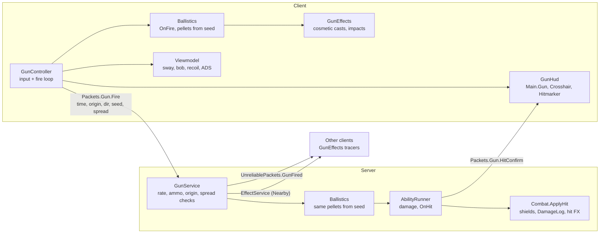

# Adding guns

This guide covers the gun system in the FPS place: how it fits together, how to add a gun, how to write an ability, and what to check when something goes wrong. For the architecture alone, see [GUN_SYSTEM.md](GUN_SYSTEM.md).

## Overview

A gun is **one definition file + one model**. Everything else (input, networking, server checks, damage, viewmodel, effects, UI) is shared code that reads the definition.

**NPCs use guns automatically.** A profile in `Content.NPC.Profiles` names gun Ids, and NPCs fire them through `GunService.FireAs` with the same rules, damage, abilities, effects and sounds as players. A new gun needs no NPC code; see [ADDING_NPCS.md](ADDING_NPCS.md).



The client sends only intent: a trigger pull with a timestamp, origin, aim direction, random seed and the spread it used. The server checks it, rebuilds the same pellets from the seed and decides every hit. Other clients get the same seed and draw matching tracers.

## Folder map

```
ReplicatedStorage
├─ Content/Guns/
│  ├─ Registry            { [GunId] = definition }, built from Definitions, with defaults and checks
│  ├─ Types               GunDefinition, AbilityModule, ShotContext, HitResult ... types
│  ├─ Definitions/        one ModuleScript per gun: Rifle, Pistol, Shotgun, BurstRifle
│  ├─ Abilities/          one ModuleScript per ability: ShotgunSpread, Burst, ExplosiveRounds, Scope, Ricochet
│  └─ Loadouts            the loadouts players pick (up to 3 guns each); saved per player
├─ Content/Effects/
│  ├─ Registry            GunFire_<Id>, BulletImpact, Reload, DryFire, Hitmarker, Explosion
│  └─ Parts/              MuzzleFlash, PooledSound, Shell, Impact (pooled effect kinds)
├─ Assets/
│  ├─ Models/Guns/<Model> gun models (Handle + attachments)
│  ├─ Models/Viewmodel    first-person arms rig
│  ├─ Sounds/             RifleFire, PistolFire, ShotgunFire, Reload, DryFire, Explosion, Hitmarker, BodyHit, HeadshotHit
│  ├─ Vfx/                MuzzleFlash, BulletImpact, BulletHole, ShellEject, Tracer, TracerRed, Explosion
│  └─ UI/Templates/       ScopeOverlay, LoadoutCard, KeybindRow, VolumeRow
├─ Modules/Shared/PlayerSettings     rebindable actions, volume groups, saved Settings fields
├─ Modules/Shared/Guns/
│  ├─ Ballistics          shots, pellets, FastCast2 casters, hitscan traces, pierce/bounce rule
│  ├─ Abilities           calls ability hooks on the right side
│  ├─ Spread              cone math (--!native)
│  └─ Spring              damped spring (--!native)
├─ Modules/Shared/Packets            Gun group (+ Gun.Loadout), Settings group
├─ Modules/Shared/UnreliablePackets  GunFired, GunAim, GunAimRelay
├─ Modules/Client/Core/Menus         which menu is open; frees the mouse, blocks gun input
├─ Modules/Client/Settings/
│  ├─ Keybinds            the player's keys per action; rebinding swaps conflicts
│  └─ SettingsMenu        keybind rows and volume sliders
└─ Modules/Client/Guns/
   ├─ GunController       input (KB/M, gamepad, touch), fire loop, reload, ADS
   ├─ WeaponSlots         switching: 1/2/3, mouse wheel, gamepad L1/R1, the right-side slots
   ├─ LoadoutMenu         the loadout cards
   ├─ Viewmodel           arms + gun on the camera
   ├─ GunEffects          local and remote cosmetic shots
   ├─ GunHud              updates the UI in StarterGui.Main
   └─ Quality             particle scaling by graphics quality and device

ServerScriptService/Modules
├─ Systems/Guns/
│  ├─ GunService          Give, equips, ammo, fire-rate checks, server casts
│  ├─ LoadoutService      gives the picked loadout on every spawn, Slot attributes, saves picks
│  └─ AbilityRunner       damage per bullet, server ability hooks
└─ Services/
   ├─ SettingsService     checks and saves keybind and volume changes
   └─ CmdrSetup/
      ├─ Commands/GiveGun, GiveGunServer   givegun <player> <gunId>
      └─ Types/Gun                         the "gun" argument type

StarterGui/Main   (ZIndexBehavior Global: children need a higher ZIndex than their parent)
├─ Gun          GunName, Ammo, Reserve, FireMode, ReloadBar.Bar, ReloadText
├─ Crosshair    Top, Bottom, Left, Right, Dot, UIScale (hidden while aiming)
├─ Hitmarker    four ticks
├─ Weapons      Slot1..Slot3 (Key, GunName), right side
├─ MenuButtons  LoadoutButton, SettingsButton, top right
├─ Loadout      Title, Close, Body.List (LoadoutCards)
├─ Settings     Title, Close, Body.Controls (KeybindRows), Body.ResetKeys, Body.Audio (VolumeRows)
└─ Mobile       FireButton, AimButton, ReloadButton (next to Swing, Sprint, Grab)
```

## Add a gun in 3 steps

### 1. Build the model

Put a `Model` in `ReplicatedStorage.Assets.Models.Guns`. The barrel points along **−Z** of the Handle (the Handle's LookVector is "forward").

| Part / attachment | Where | Required | Used for |
| --- | --- | --- | --- |
| `Handle` (BasePart, PrimaryPart) | The pistol grip | **Yes** | The Tool's handle; everything welds to it |
| `Handle.Muzzle` (Attachment) | Tip of the barrel | **Yes** | Muzzle flash, gunfire sound, tracer start |
| `Handle.Aim` (Attachment) | On the line through the rear notch and the top of the front sight, facing forward | Recommended | Lines up with the camera when aiming. Without it, set `Viewmodel.ADSOffset` |
| `RearSightL`, `RearSightR`, `FrontSight` (BaseParts) | A notch at the back, a post or bead at the front | Recommended | Iron sights: the front sight's tip sits between the rear ears when aiming |
| `Handle.EjectionPort` (Attachment) | The right side of the receiver | Optional | Shell casings fly out of here |
| `Handle.RightGrip` (Attachment) | Where the right hand holds | Optional | The viewmodel's right arm reaches here |
| `Handle.LeftGrip` (Attachment) | Where the left hand holds | Optional | The viewmodel's left arm reaches here |
| `Magazine` (BasePart) | Anywhere | Optional | For reload animations |

Checklist:

- [ ] Every other part is welded to `Handle` with a `WeldConstraint`, unanchored (the viewmodel swaps these for fixed `Weld`s on its own copy)
- [ ] Iron sights are thin: nothing taller than the front post sits between the rear notch and the muzzle
- [ ] `CanCollide`, `CanTouch` and `CanQuery` are off, and `Massless` is on
- [ ] Keep it to a handful of parts (the starter guns use 5 to 7)
- [ ] The model's `PrimaryPart` is `Handle`

The model is drawn at full size in third person (as the Tool), and at 45% in first person (`Viewmodel.SCALE`).

### 2. Write the definition

Add a `ModuleScript` to `ReplicatedStorage.Content.Guns.Definitions`. Only `Id`, `Model` and `Damage` are required; every other field gets the default in the table below.

```lua
--!strict
--[[
	SMG: fast and inaccurate.
]]

return {
	Id = "SMG",
	DisplayName = "SMG",
	Model = "SMG",
	FireMode = "Auto",
	FireRate = 850,
	Damage = 16,
	MagSize = 35,
	ReserveAmmo = 140,
	Spread = { Hip = 3.5, ADS = 1, PerShot = 0.4 },
	Effects = { Fire = "GunFire_SMG" },
}
```

If you give it a new `Effects.Fire` name, add that entry to `Content.Effects.Registry` (see [Adding effects](#adding-effects-to-the-registry)). Otherwise point it at an existing one, like `"GunFire_Rifle"`.

### 3. Test with `givegun`

Play the game, open Cmdr (the key is usually `F2`), and run:

```
givegun me SMG
```

It lands in your next free slot; switch to it with that slot's key, or the mouse wheel. To give it on every spawn, add it to a loadout (below). Check the Output window for `Gun SMG:` warnings from the registry: a missing model, attachment or ability is reported there when the game starts. Your user id must be in `Modules.Classes.Admins` to run commands.

## Adding a loadout

Players pick a loadout in the Loadout menu (it opens when they join, and with `B`). `Systems.Guns.LoadoutService` gives its guns on every spawn, sets each Tool's `Slot` attribute and equips slot 1. The pick is saved in the player's data.

Add an entry to the list in `ReplicatedStorage.Content.Guns.Loadouts`, at most three guns, in slot order:

```lua
{ Id = "Sniper", DisplayName = "Sniper", Description = "Long range with a pistol backup.", Guns = { "SniperRifle", "Pistol" } },
```

It gets a card in the menu with no other change. Gun names are Ids in `Content.Guns.Registry`.

| Loadout | Slot 1 | Slot 2 | Slot 3 |
| --- | --- | --- | --- |
| Assault (default) | Rifle | Pistol | |
| Breacher | Shotgun | Pistol | |
| Grenadier | Burst Rifle | Pistol | |
| Arsenal | Rifle | Shotgun | Pistol |

## Controls and settings

The Settings menu (`P`) rebinds keys, sets volumes, FOV and camera bob, and switches the movement toggles. All are saved in the player's data under `Settings`, written only by `Services.SettingsService`.

| Action | Default key | Gamepad (fixed) |
| --- | --- | --- |
| Fire | Left mouse | R2 |
| Aim down sights | Right mouse | L2 |
| Reload | R | X |
| Gun ability | F | Y |
| Weapon 1, 2, 3 | 1, 2, 3 | L1 / R1 cycle |
| Next / previous weapon | Mouse wheel | L1 / R1 |
| Loadout menu | B | |
| Settings menu | P | |
| Sprint (double-tap: tactical sprint) | Left Shift | Left stick click (toggles) |
| Crouch / slide | C | B |
| Prone | Left Ctrl | Hold B |
| Interact (repair boards, any prompt) | E | DPad Up |

Movement, the FOV slider and the movement toggles are covered in [MOVEMENT.md](MOVEMENT.md). For guns, the parts that matter are `SprintOutTime`, `MoveSpeedMultiplier` and the `Spread.Crouch` / `Spread.Slide` fields below.

To add a rebindable action, add it to `ACTIONS` in `Shared.PlayerSettings` (a saved field and a menu row come with it), then read its key with `Keybinds.Get("Name")` and rebind on `Keybinds.Changed`. Volume sliders come from `VOLUME_GROUPS` there and drive `Client.Audio.AudioSettings`.

While a menu is open, `Client.Core.Menus` frees the mouse and the gun takes no input. In first person the cursor is locked to the center, so on PC the menus and slots are reached with their keys; on touch they are tapped.

## Definition reference

| Field | Type | Default | Meaning |
| --- | --- | --- | --- |
| `Id` | string | file name | Unique key in the registry and in `givegun` |
| `DisplayName` | string | `Id` | Tool name, HUD name, kill-feed item |
| `Model` | string | `Id` | Model in `Assets.Models.Guns` |
| `FireMode` | `"Semi"` \| `"Auto"` \| `"Burst"` | `"Semi"` | Trigger behavior |
| `FireRate` | number | `400` | Rounds per minute (between shots inside a burst, for Burst) |
| `Burst.Count` | number | `3` | Shots per trigger pull in Burst mode |
| `Burst.Cooldown` | number | `0.25` | Seconds after a burst |
| `Damage` | number | **required** | Damage per bullet (per pellet for shotguns) |
| `HeadshotMultiplier` | number | `1.5` | Damage × this on the head or a hat |
| `Falloff.Start` | number | `60` | Studs before damage drops |
| `Falloff.End` | number | `150` | Studs where damage reaches `Min` |
| `Falloff.Min` | number | `0.6` | Damage multiplier at `End` and beyond |
| `Pellets` | number | `1` | Bullets per shot |
| `MagSize` | number | `12` | Magazine size |
| `ReserveAmmo` | number | `60` | Starting reserve |
| `ReloadTime` | number | `1.8` | Seconds |
| `EquipTime` | number | `0.35` | Seconds before the first shot |
| `ADSTime` | number | `0.18` | Seconds to aim in |
| `ADSFov` | number | `55` | Field of view while aiming, written for a base FOV of 70. The camera uses `playerFov × ADSFov / 70`, so the zoom is the same at any FOV setting |
| `SprintOutTime` | number | `0.15` | Seconds after a sprint ends before the gun can fire or aim. Doubled after a tactical sprint (`Config.TacticalOutMultiplier`). The server checks it too |
| `MoveSpeedMultiplier` | number | `1` | Movement speed while this gun is held. Below 1 for heavy guns (clamped to 0.1–2) |
| `Projectile.CastType` | `"Raycast"` \| `"Blockcast"` \| `"Spherecast"` | `"Raycast"` | Shape of the bullet |
| `Projectile.Speed` | number | `900` | Studs/second (tracer speed for hitscan) |
| `Projectile.Gravity` | number | `0` | Bullet drop, studs/second² |
| `Projectile.MaxDistance` | number | `1000` | Studs |
| `Projectile.Pierce` | number | `0` | Surfaces a bullet goes through |
| `Projectile.Hitscan` | boolean | `false` | `true`: the server hits instantly; `false`: the server simulates the bullet with FastCast2 |
| `Projectile.Size` | Vector3 | `0.3, 0.3, 0.3` | Blockcast box |
| `Projectile.Radius` | number | `0.25` | Spherecast radius |
| `Spread.Hip` | number | `2.5` | Cone half-angle (degrees) from the hip |
| `Spread.ADS` | number | `0.4` | Cone while aiming |
| `Spread.Move` | number | `1.5` | Added at full walk speed |
| `Spread.PerShot` | number | `0.3` | Bloom per shot |
| `Spread.Recovery` | number | `6` | Bloom removed per second |
| `Spread.Max` | number | `10` | Upper limit (the server clamps to it) |
| `Spread.Crouch` | number | `0.7` | Multiplies `Hip` and `ADS` while crouched or sliding |
| `Spread.Slide` | number | `2` | Degrees added while sliding (replaces the `Move` term). Hip fire works during a slide |
| `Spread.Prone` | number | `0.5` | Multiplies `Hip` and `ADS` while prone |
| `Recoil.Vertical` | number | `1` | Degrees the camera climbs per shot |
| `Recoil.Horizontal` | number | `0.3` | Degrees of random sideways kick |
| `Recoil.Kick` | number | `0.08` | Studs the viewmodel pushes back |
| `Recoil.Recovery` | number | `10` | Spring speed back to center |
| `Viewmodel.Offset` | CFrame | `CFrame.new(0.5, -0.55, -1.9)` | Hip position from the camera (full scale) |
| `Viewmodel.ADSOffset` | CFrame? | from `Aim` | Aimed position. Leave it out to use the `Aim` attachment |
| `Viewmodel.Sway` | number | `1` | Sway multiplier |
| `Viewmodel.Bob` | number | `1` | Walk bob multiplier |
| `Animations.Idle / Fire / Reload / Equip` | string | none | Animation ids for the viewmodel rig (Motor6Ds `Left Shoulder`, `Right Shoulder`, `Handle`) |
| `Effects.Fire` | string | `"GunFire_<Id>"` | Registry effect at the muzzle |
| `Effects.Impact` | string | `"BulletImpact"` | Registry effect where bullets land |
| `Effects.Reload` | string | `"Reload"` | Registry effect when a reload starts |
| `Effects.Empty` | string | `"DryFire"` | Registry effect on an empty trigger pull |
| `Effects.Tracer` | string | `"Tracer"` | Part in `Assets.Vfx` used as the cosmetic bullet |
| `Abilities` | { string } | `{}` | Module names in `Content.Guns.Abilities` |

## Writing an ability

An ability is a `ModuleScript` in `Content.Guns.Abilities` that returns a table of optional hooks. The runner calls the hooks that exist; adding an ability never needs a change to core files. Turn it on by naming it in a gun's `Abilities`.

| Hook | Default side | Arguments | Use it to |
| --- | --- | --- | --- |
| `ModifyStats` | Shared | `stats` | Change the gun's stats once, at load |
| `OnEquip` / `OnUnequip` | Shared | `ctx: GunContext` | Set up and clean up |
| `OnFire` | Shared | `ctx: ShotContext` | Change the shot: `ctx.Spread`, `ctx.Pellets`, `ctx.Projectile`, `ctx.DamageMultiplier` |
| `CanPierce` | Shared | `ctx, hit, velocity, bullet` | Return `true` to let a bullet continue, plus a new velocity to bounce it |
| `OnHit` | Server | `ctx, hit, bullet` | Change `hit.Damage`, or add effects like explosions |
| `OnReload` | Shared | `ctx: GunContext` | React to a reload starting |
| `OnAltFire` | Client | `ctx, active, source` | React to the aim key (`"Aim"`) or the ability key, F / gamepad Y (`"Ability"`) |

Override a side with `Sides = { OnAltFire = "Shared" }`. A server or shared `OnAltFire` is sent to the server automatically.

Rules:

- **`OnFire` must use only `ctx.Random`** for anything random. The shooter, the server and every other client run it with the same seed, so they must all make the same bullets.
- Server hooks deal damage only through `ctx.ApplyHit(humanoid, damage)`, which applies `Gun.DamageMultiplier`, then `Combat.ApplyHit` with the shooter as attacker. Shields, kill credit, hit and kill sounds, and `Gun.Killed` then all work.
- The shooter may be an NPC: then `ctx.Player` is nil and `ctx.Character` is the NPC's model. Use `ctx.Character` for "the shooter's body" (as `ExplosiveRounds` does to skip itself).

### Extension points

Every point gets `who`: the Player, or the NPC's model.

| Point | Kind | Arguments | Use it to |
| --- | --- | --- | --- |
| `Gun.PreventFire` | Any | who, gunId, tool | Stop a shot (true) |
| `Gun.DamageMultiplier` | Product | who, gunId, humanoid, hit (nil for ability damage) | Scale damage; NPCs use it to turn off friendly fire |
| `Gun.Hit` | Fire | who, humanoid, hit, gunId | React to a bullet hitting a humanoid |
| `Gun.Killed` | Fire | who, victimHumanoid, gunId, headshot | A kill feed or streaks; fires once, on the hit that took health from above 0 to 0 or below |
| `Gun.Reloaded` | Fire | who, tool, gunId | React to a finished reload |
- Play effects with `ctx.PlayEffect(name, options)`. On the server it is sent to clients; on a client it plays there.
- Don't `require` anything in `ServerScriptService`: the file also loads on clients.

### Example: Lifesteal

Heals the shooter for a share of the damage each bullet deals.

```lua
--!strict
--[[
	Lifesteal (server)

	The shooter heals for SHARE of the damage each bullet deals to a humanoid.

		OnHit  Server  Heals the shooter after damage is worked out
]]

local Types = require(game:GetService("ReplicatedStorage").Content.Guns.Types)

local SHARE = 0.25

local Lifesteal: Types.AbilityModule = {
	Name = "Lifesteal",
}

function Lifesteal.OnHit(ctx: Types.ShotContext, hit: Types.HitResult, _bullet: Types.Bullet)
	local player = ctx.Player
	local humanoid = player and player.Character and player.Character:FindFirstChildOfClass("Humanoid")
	if humanoid and hit.Humanoid and hit.Damage > 0 then
		humanoid.Health = math.min(humanoid.MaxHealth, humanoid.Health + hit.Damage * SHARE)
	end
end

return Lifesteal
```

Then add it to a gun: `Abilities = { "Lifesteal" }`.

The shipped abilities show each kind of hook:

| Ability | Hooks | What it shows |
| --- | --- | --- |
| `ShotgunSpread` | `ModifyStats`, `OnFire` | Multi-pellet shots from one seed |
| `Burst` | `ModifyStats` | Changing the fire mode |
| `ExplosiveRounds` | `OnHit` (server) | Area damage through `ctx.ApplyHit`, plus a server effect |
| `Scope` | `OnAltFire`, `OnUnequip` (client) | A sniper scope: zoom, hiding the viewmodel, cloning a UI template. No starter gun uses it; add it to a sniper |
| `Ricochet` | `CanPierce`, `OnHit` | Bouncing bullets through FastCast2's pierce callback |

## Adding effects to the Registry

Every sound and visual is an entry in `ReplicatedStorage.Content.Effects.Registry`. Gunfire uses the `gunFire` helper at the top of that file:

```lua
GunFire_SMG = gunFire("SMGFire", 0.6, true), -- sound in Assets.Sounds, volume, eject shells
```

| Entry | Replicate | Kinds | Notes |
| --- | --- | --- | --- |
| `GunFire_<Id>` | `Nearby`, 400 studs | `PooledSound`, `MuzzleFlash`, `Shell` | Played on the `Muzzle` attachment. The server sends it to everyone except the shooter, whose client already played it |
| `BulletImpact` | `Local` | `Impact` | Each client plays it for its own cosmetic bullets |
| `Reload` | `Nearby`, 120 studs | `Sound` | |
| `DryFire` | `Local` | `PooledSound` | |
| `Hitmarker` | `Local` | `Sound` | The shooter's hit sound: click + `BodyHit`, or click + `HeadshotHit` with `Variant = "Headshot"` |
| `Explosion` | `Nearby`, 500 studs | `Sound`, `Particles` | Used by `ExplosiveRounds` |

The gun kinds in `Content.Effects.Parts` reuse what they make: they create their instances once, then pool them.

| Kind | Fields | Pools |
| --- | --- | --- |
| `MuzzleFlash` | `Asset`, `Count`, `LightTime` | Emitters and light copied onto each muzzle once |
| `PooledSound` | `Asset`, `Volume`, `Pitch`, `RollOff`, `Voices` | `Voices` copies per muzzle, round-robin |
| `Shell` | `Asset`, `Attachment`, `Speed`, `Lifetime`, `Pool` | `Pool` casings, oldest reused |
| `Impact` | `Asset`, `Count`, `Hole`, `Pool`, `Holes`, `Materials` | `Pool` anchors and `Holes` bullet holes, oldest reused |

To add a new kind, copy `Content.Effects.Parts.Template`: a module with `Play(spec, context)`, tagged `ClientOnly`.

Tracers are not registry effects. They are the cosmetic bullets FastCast2 moves, and `Effects.Tracer` names the part in `Assets.Vfx` to use. Each gun's client caster pools them with `ObjectCache`.

## Adding UI

UI is built in Studio under `StarterGui.Main`; scripts only find and update it. Never create UI with `Instance.new` in a script.

1. Add the frame in Studio, inside `Main`.
2. Find it in `Client.Guns.GunHud` with `WaitForChild` and add a function that updates it.
3. Call that function from `GunController` (or from an ability's client hook).

The one exception is cloning a template. Put the template in `ReplicatedStorage.Assets.UI.Templates` and `:Clone()` it, as `Scope` does with `ScopeOverlay`. Reuse `Packages.UI`: `AnimatedBar` (the reload bar), `ButtonHover` (the mobile aim toggle) and `BounceEffects` (menus). Mobile buttons go in `Main.Mobile`. Their `Position` and `Size` are in units of the `Mobile` frame, which `Client.Core.UI` resizes for phones and tablets.

A new full-screen menu: build its frame in `Main` with a `Close` button, call `Menus.Register(name, frame)`, and open it with `Menus.Toggle(name)`. `Main` uses Global ZIndex, so give everything inside a menu a higher `ZIndex` than the menu itself (and templates cloned into it higher still), or the menu's background covers its own buttons.

## Performance checklist

- [ ] **One caster per gun per side.** `Ballistics.Caster` makes it on first use and reuses it. Never call `FastCast.new()` per shot.
- [ ] **Serial casters.** A gun fires at most a few dozen bullets a second, which the Serial caster handles with less overhead than handing work to actors. Only consider `FastCast.newParallel()` if one gun launches hundreds of projectiles at once.
- [ ] **Everything cosmetic is pooled.** Tracers use `ObjectCache`; flashes, gunfire sounds, shells, impacts and bullet holes are pooled by their effect kinds. Nothing cosmetic is created and destroyed per shot.
- [ ] **Active effects are capped.** Impacts by `Pool` and `Holes`, shells by `Pool`, and other players' shots at 6 per frame (`GunEffects.MAX_REMOTE_SHOTS_PER_FRAME`).
- [ ] **Particle counts scale.** `Client.Guns.Quality` lowers them on low graphics quality and on touch devices, and turns off muzzle lights and shells at the lowest levels.
- [ ] **Bindings only while held.** There is one `Heartbeat` connection (the fire loop) and one `BindToRenderStep` (the viewmodel, at Camera + 1), both connected only while a gun is equipped.
- [ ] **Batched replication.** A shot is one packet with a seed; pellets are never sent one by one. Tracers for other players and aim pitch go through `UnreliablePackets`.
- [ ] **No per-frame tables.** The viewmodel reuses its springs and constant CFrames. CFrame math still makes value temporaries, but no tables or closures.
- [ ] **Hot math is native.** `Spring` and `Spread` use `--!strict` and `--!native`.

## Troubleshooting

| Symptom | Likely cause | Fix |
| --- | --- | --- |
| `Gun X: no model named Y in Assets.Models.Guns` | `Model` doesn't match a model name | Rename the model or fix `Model` |
| `Gun X: model Y has no Muzzle attachment` | Missing attachment, or it's not directly in `Handle` | Add `Handle.Muzzle` |
| `Gun X: no ability named Z` | Typo, or the module isn't in `Content.Guns.Abilities` | Fix the name in `Abilities` |
| `givegun` says the gun doesn't exist | The definition failed to load (see Output), or `Damage` is missing | Fix the definition; `Damage` must be a number |
| Gun equips but won't fire | Still raising (`EquipTime`), reloading, out of ammo, stunned, or a `Gun.PreventFire` handler returns true | Check the player's `Reloading`, `Stunned` and `CantDoAnything` attributes and the Tool's `Ammo` attribute |
| Shots fire locally but deal no damage | The server refused them: fire rate too high for `FireRate`, origin too far from the head, or the client clock is off | Make sure `FireRate` matches how fast the gun really fires; the server allows a few shots of jitter |
| Ammo count jumps back up | Predicted ammo resynced with the server after refused shots | Same as above: find why the server refused them |
| Aiming looks off-center | The `Aim` attachment isn't on the line through the sights, or isn't facing −Z | Move or rotate `Handle.Aim`, or set `Viewmodel.ADSOffset` |
| Crosshair lines vanish | A convert-to-scale plugin was run on `Main.Crosshair` while it had no size | Keep `Main.Crosshair` at a real size (48×48); its lines are placed from its center |
| Arms point the wrong way | `RightGrip` / `LeftGrip` missing or misplaced | Add them where the hands go |
| Viewmodel shows in third person, or the tool shows in first person | The camera isn't within 1.5 studs of the head | The controller locks first person while a gun is held; check that nothing else changes `CameraMode` |
| Sound plays twice for the shooter | The server effect wasn't sent with the shooter as `except` | Use `EffectService.Play(name, options, shooter)` for effects the shooter's client already played |
| The camera drifts after shooting | Something else writes `camera.CFrame` after Camera + 1 | Recoil is applied as a per-frame change; don't set the camera to an absolute aim every frame while a gun is held |
| Other players' tracers don't appear | `GunFired` is unreliable and can drop under load, or the shooter is beyond 600 studs | That's expected; increase `TRACER_RANGE` in `GunService` if needed |
| A menu's buttons can't be clicked | `Main` uses Global ZIndex and the menu frame is above its children | Give the menu's descendants a higher `ZIndex` than the menu |
| Clicking menu buttons with a gun held does nothing | First person locks the cursor to the center | Open menus with their keys (`B`, `P`); `Client.Core.Menus` frees the mouse while one is open |
| A new loadout gives no guns | A name in `Guns` isn't a gun Id | Use Ids from `Content.Guns.Registry` |
| A module fails with "Ambiguous syntax" | A line starts with `(` right after an expression | Put the value in a local first, or end the line before with `;` |
