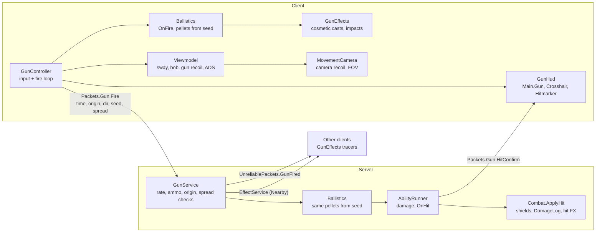

# Adding guns

This guide covers the gun system in the FPS place: how it fits together, how to add a gun, how to write an ability, and what to check when something goes wrong. For the architecture alone, see [GUN_SYSTEM.md](GUN_SYSTEM.md).

## Overview

A gun is **one definition file + one model**. Everything else (input, networking, server checks, damage, viewmodel, effects, UI) is shared code that reads the definition.

**NPCs use guns automatically.** A profile in `Content.NPC.Profiles` names gun Ids, and NPCs fire them through `GunService.FireAs` with the same rules, damage, abilities, effects and sounds as players. A new gun needs no NPC code; see [ADDING_NPCS.md](ADDING_NPCS.md).



The client sends only intent: a trigger pull with a timestamp, origin, aim direction, random seed and the spread it used. The server checks it, rebuilds the same pellets from the seed and decides every hit. Other clients get the same seed and draw matching tracers.

## Folder map

```
ReplicatedStorage
├─ Content/Guns/
│  ├─ Registry            { [GunId] = definition }, built from Definitions, with defaults and checks
│  ├─ Types               GunDefinition, AbilityModule, ShotContext, HitResult ... types
│  ├─ Definitions/        one ModuleScript per gun: Rifle, Pistol, Shotgun, BurstRifle, SMG, LMG
│  ├─ Abilities/          one ModuleScript per ability: ShotgunSpread, Burst, ExplosiveRounds, Scope, Ricochet
│  ├─ Loadouts            the loadouts players pick (up to 3 guns each, plus the knife); saved per player
│  ├─ Melee               gun bash numbers: a default plus per-gun overrides
│  └─ Skins               gun skins (dev-made)
├─ Content/Effects/
│  ├─ Registry            GunFire_<Id>, BulletImpact, Reload, DryFire, Hitmarker, Explosion, MeleeSwing, MeleeImpact
│  └─ Parts/              MuzzleFlash, PooledSound, Shell, Impact (pooled effect kinds)
├─ Assets/
│  ├─ Models/Guns/<Model> gun models (Handle + attachments); also Knife, and Revolver
│  ├─ Models/Viewmodel    first-person arms rig
│  ├─ Sounds/             RifleFire, PistolFire, ShotgunFire, Reload, DryFire, Explosion, Hitmarker, BodyHit, HeadshotHit
│  ├─ Vfx/                MuzzleFlash, BulletImpact, BulletHole, ShellEject, Tracer, TracerRed, Explosion
│  └─ UI/Templates/       ScopeOverlay, LoadoutCard, KeybindRow, VolumeRow
├─ Modules/Shared/PlayerSettings     rebindable actions, volume groups, saved Settings fields
├─ Modules/Shared/Guns/
│  ├─ Ballistics          shots, pellets, FastCast2 casters, hitscan traces, pierce/bounce rule
│  ├─ Abilities           calls ability hooks on the right side
│  ├─ Spread              cone math (--!native)
│  └─ Spring              damped spring (--!native)
├─ Modules/Shared/Packets            Gun group (+ Gun.Loadout), Melee group, Settings group
├─ Modules/Shared/UnreliablePackets  GunFired, GunAim, GunAimRelay
├─ Modules/Client/Core/Menus         which menu is open; frees the mouse, blocks gun input
├─ Modules/Client/Settings/
│  ├─ Keybinds            the player's keys per action; rebinding swaps conflicts
│  └─ SettingsMenu        keybind rows and volume sliders
└─ Modules/Client/Guns/
   ├─ GunController       input (KB/M, gamepad, touch), fire loop, reload, ADS
   ├─ WeaponSlots         switching: 1/2/3, mouse wheel, gamepad L1/R1, the right-side slots
   ├─ LoadoutMenu         the loadout cards
   ├─ Recoil              recoil pattern, camera and viewmodel springs (pure math, testable in Edit mode)
   ├─ AimAssist           friction and pull for controller and touch (see Aim assist)
   ├─ Viewmodel           arms + gun on the camera
   │  ├─ GunModel         scaled gun copies, skins on them, the near guard's boxes
   │  └─ Actions          procedural reload, inspect, knife swing and gun bash
   ├─ GunEffects          local and remote cosmetic shots
   ├─ GunHud              updates the UI in StarterGui.Main
   └─ Quality             particle scaling by graphics quality and device

ServerScriptService/Modules
├─ Systems/Guns/
│  ├─ GunService          Give, equips, ammo, fire-rate checks, server casts
│  ├─ LoadoutService      gives the picked loadout on every spawn, Slot attributes, saves picks
│  └─ AbilityRunner       damage per bullet, server ability hooks
├─ Systems/Combat/
│  └─ GunMelee            the gun bash: checks, hit query, damage, boards, soft walls
└─ Services/
   ├─ SettingsService     checks and saves keybind and volume changes
   └─ CmdrSetup/
      ├─ Commands/GiveGun, GiveGunServer   givegun <player> <gunId>
      └─ Types/Gun                         the "gun" argument type

StarterGui/Main   (ZIndexBehavior Global: children need a higher ZIndex than their parent)
├─ Gun          GunName, Ammo, Reserve, FireMode, ReloadBar.Bar, ReloadText
├─ Crosshair    Top, Bottom, Left, Right, Dot, UIScale (hidden while aiming)
├─ Hitmarker    four ticks
├─ Weapons      Slot1..Slot3 (Key, GunName), right side
├─ MenuButtons  LoadoutButton, SettingsButton, top right
├─ Loadout      Title, Close, Body.List (LoadoutCards)
├─ Settings     Title, Close, Body.Controls (KeybindRows), Body.ResetKeys, Body.Audio (VolumeRows)
└─ Mobile       FireButton, AimButton, ReloadButton, BashButton (next to Swing, Sprint, Grab); ConsumableButton; CmdrButton (admins)
```

## Add a gun in 3 steps

### 1. Build the model

Put a `Model` in `ReplicatedStorage.Assets.Models.Guns`. The barrel points along **−Z** of the Handle (the Handle's LookVector is "forward").

| Part / attachment | Where | Required | Used for |
| --- | --- | --- | --- |
| `Handle` (BasePart, PrimaryPart) | The pistol grip | **Yes** | The Tool's handle; everything welds to it |
| `Handle.Muzzle` (Attachment) | Tip of the barrel | **Yes** | Muzzle flash, gunfire sound, tracer start |
| `Handle.Aim` (Attachment) | On the line through the rear notch and the top of the front sight, facing forward | Recommended | Lines up with the camera when aiming. Without it, set `Viewmodel.ADSOffset` |
| `RearSightL`, `RearSightR`, `FrontSight` (BaseParts) | A notch at the back, a post or bead at the front | Recommended | Iron sights: the front sight's tip sits between the rear ears when aiming |
| `Handle.EjectionPort` (Attachment) | The right side of the receiver | Optional | Shell casings fly out of here |
| `Handle.RightGrip` (Attachment) | Where the right hand holds | Recommended | The viewmodel's right arm reaches here |
| `Handle.LeftGrip` (Attachment) | Where the left hand holds (the handguard or pump) | Recommended | The viewmodel's left arm reaches here |
| `Magazine` (BasePart) | Anywhere | Optional | The procedural reload and inspect pull it out. Without a visible one (Transparency below 1), the left hand only reaches under the grip |

Checklist:

- [ ] Every other part is welded to `Handle` with a `WeldConstraint`, unanchored (the viewmodel swaps these for fixed `Weld`s on its own copy)
- [ ] Iron sights are thin: nothing taller than the front post sits between the rear notch and the muzzle
- [ ] `CanCollide`, `CanTouch` and `CanQuery` are off, and `Massless` is on
- [ ] Keep it to a handful of parts (the starter guns use 5 to 7)
- [ ] The model's `PrimaryPart` is `Handle`
- [ ] Every attachment is directly in `Handle`, with no rotation (they face the Handle's −Z)

The model is drawn at full size in third person (as the Tool), and at 32% in first person (`Viewmodel.GunModel.SCALE`).

**An imported mesh.** A gun made of one MeshPart (the SMG and Shotgun are) often comes in lying on its side, with its own axes. Don't rotate the mesh; give it a Handle instead:

1. Add an invisible `Part` named `Handle` (Transparency 1, about 0.25 × 0.6 × 0.3) at the pistol grip, turned so its −Z points down the barrel and +Y up.
2. Put `Muzzle`, `Aim`, `RightGrip`, `LeftGrip` and `EjectionPort` in the Handle (not in the mesh), with no rotation.
3. Weld the mesh to it with a `WeldConstraint` (Part0 Handle), set the model's `PrimaryPart` to `Handle`, and turn off `CanCollide`, `CanQuery` and `CanTouch` on the mesh, with `Massless` on.

To place `Aim` on a mesh with no separate sight parts, find the tops of the rear sight and the front bead (raycast down onto a clone in Edit mode) and put `Aim` just above the line between them. Then check by script that the model has `Handle.Muzzle`, `Handle.Aim`, `Handle.RightGrip` and `Handle.LeftGrip`.

### 2. Write the definition

Add a `ModuleScript` to `ReplicatedStorage.Content.Guns.Definitions`. Only `Id`, `Model` and `Damage` are required; every other field gets the default in the table below.

```lua
--!strict
--[[
	Carbine: a short rifle. Every field is listed in docs/ADDING_GUNS.md. Leave a field out to use its default.
]]

return {
	Id = "Carbine",
	DisplayName = "Carbine",
	Model = "Carbine",
	FireMode = "Auto",
	FireRate = 700,
	Damage = 14,
	MagSize = 30,
	ReserveAmmo = 120,
	Spread = { Hip = 3, ADS = 0.6, PerShot = 0.35 },
	Recoil = { Vertical = 0.8, Drift = 0.3, FirstShot = 1.2 },
	Effects = { Fire = "GunFire_Carbine" },
}
```

If you give it a new `Effects.Fire` name, add that entry to `Content.Effects.Registry` (see [Adding effects](#adding-effects-to-the-registry)). Otherwise point it at an existing one, like `"GunFire_Rifle"`.

### 3. Test with `givegun`

Play the game, open Cmdr (the key is usually `F2`), and run:

```
givegun me Carbine
```

It lands in your next free slot; switch to it with that slot's key, or the mouse wheel. To give it on every spawn, add it to a loadout (below). Check the Output window for `Gun Carbine:` warnings from the registry: a missing model, attachment or ability is reported there when the game starts. Your user id must be in `Modules.Classes.Admins` to run commands.

## Adding a loadout

Since 2026-11-12 nothing opens the Loadout menu (no key, no button, not on join) and the server refuses a pick in the lobby; a player has their saved loadout, or the default. Before that, players picked a loadout in the Loadout menu. `Systems.Guns.LoadoutService` gives its guns on every spawn, sets each Tool's `Slot` attribute and equips slot 1. The pick is saved in the player's data.

Add an entry to the list in `ReplicatedStorage.Content.Guns.Loadouts`, at most three guns, in slot order. The knife always takes the slot after the last gun (slot 3 in a two-gun loadout, slot 4 in a three-gun one):

```lua
{ Id = "Sniper", DisplayName = "Sniper", Description = "Long range with a pistol backup.", Guns = { "SniperRifle", "Pistol" } },
```

It gets a card in the menu with no other change. Gun names are Ids in `Content.Guns.Registry`.

| Loadout | Slot 1 | Slot 2 | Slot 3 |
| --- | --- | --- | --- |
| Assault (default) | Rifle | Pistol | Knife |
| Breacher | Shotgun | Pistol | Knife |
| Grenadier | Burst Rifle | Pistol | Knife |
| Arsenal | Rifle | Shotgun | Pistol (Knife in slot 4) |
| SMG (Id `Sprayer`) | SMG | Shotgun | Knife |
| Support | LMG | Pistol | Knife |
| Gunslinger | Revolver | Pistol | Knife |

## Controls and settings

The Settings menu (`P`) rebinds keys, sets volumes, FOV and camera bob, and switches the movement toggles. All are saved in the player's data under `Settings`, written only by `Services.SettingsService`.

| Action | Default key | Gamepad (fixed) |
| --- | --- | --- |
| Fire | Left mouse | R2 |
| Aim down sights | Right mouse | L2 |
| Reload | R | X |
| Gun ability | F | Y |
| Inspect | V | |
| Melee (gun bash) | Q, and middle mouse (pressing the wheel, fixed) | R3 (right stick click); touch: the BASH button |
| Throw grenade / smoke ([CONSUMABLES.md](CONSUMABLES.md)) | G | DPad Right; touch: the NADE / SMOKE button |
| Weapon 1, 2, 3, 4 | 1, 2, 3, 4 | L1 / R1 cycle |
| Next / previous weapon | Mouse wheel | L1 / R1 |
| Loadout menu | B | |
| Settings menu | P | |
| Sprint (double-tap: tactical sprint) | Left Shift | Left stick click (toggles) |
| Crouch / slide | Left Ctrl | B |
| Prone | C | Hold B |
| Interact (repair boards, any prompt) | E | DPad Up |

Movement, the FOV slider and the movement toggles are covered in [MOVEMENT.md](MOVEMENT.md). For guns, the parts that matter are `SprintOutTime`, `MoveSpeedMultiplier`, the `Spread.Crouch` / `Spread.Slide` fields and the `Recoil.ADS` / `Recoil.Crouch` / `Recoil.Prone` multipliers below.

To add a rebindable action, add it to `ACTIONS` in `Shared.PlayerSettings` (a saved field and a menu row come with it), then read its key with `Keybinds.Get("Name")` and rebind on `Keybinds.Changed`. Volume sliders come from `VOLUME_GROUPS` there and drive `Client.Audio.AudioSettings`.

While a menu is open, `Client.Core.Menus` frees the mouse and the gun takes no input. In first person the cursor is locked to the center, so on PC the menus and slots are reached with their keys; on touch they are tapped.

## Aim assist (controller and touch)

`Client.Guns.AimAssist` helps gamepad and touch players; mouse players never get it. It is on by default, and players can turn it off in Settings > Toggles ("Aim assist (controller, touch)", the `AimAssist` option). It only works while a gun is held, outside the lobby.

| Part | What it does |
| --- | --- |
| Friction | With the crosshair near an enemy, part of the player's own turn is taken out (35% from the hip, 50% aimed, at the center), so the aim slows over a target instead of sliding past |
| Pull | While the player turns or moves, the aim is drawn toward the target's chest (3/s from the hip, 5/s aimed, at most 40° per second). It never moves the aim while the player is still |

- **Targets:** other players' characters (not teammates) and NPCs in `workspace.Enemies`. They must be alive, within the gun's `Range` (250 if unset), and in clear view from the camera.
- **Cone:** 7° from the hip, 5° aimed, widened for close targets to cover about 2.2 studs of body. Both parts fade to nothing at the cone's edge.
- **Camera:** `MovementCamera` calls `AimAssist.Update` inside its own camera step and applies the result there, so the assist, recoil and the player's turn never fight over the camera.
- **Equip:** `GunController` calls `AimAssist.SetGun` on equip and unequip.
- **Server:** it never reads aim assist; bullets still go where the camera points.
- **Tuning:** the numbers are constants at the top of the module. Full details: [AIM_ASSIST.md](AIM_ASSIST.md).

## Melee (gun punch)

Any held gun can bash: **Q** (the rebindable `Melee` action), **pressing the middle mouse button** (pressing the wheel; scrolling it still switches weapons), **R3** on a gamepad, or the **BASH** button on touch (`Main.Mobile.BashButton`, shown with the other gun buttons). The two extra inputs are fixed (`PlayerSettings.MeleeMouseButton`, `PlayerSettings.MeleeGamepadKey`). The Knife keeps its own swing (`Client.Combat.SwordInput`); the bash is for firearms only.

| Step | Where | What happens |
| --- | --- | --- |
| 1 | `Client.Guns.GunController` | Refused while a menu is open, while raising the gun, while stunned, or inside the cooldown. A bash mid-reload cancels the reload (`finishReload`). Otherwise it ends aiming (and a scope), a sprint and an inspect, holds fire for 0.3 s, sends `Packets.Melee.Swing(serverTime, lookDirection)`, plays the bash (`Viewmodel.Bash`) and the `MeleeSwing` whoosh |
| 2 | `Systems.Combat.GunMelee` | Checks the timestamp (±2 s), that the look points within 100° of where the body faces, a held gun past 75% of its `EquipTime`, alive, not `Stunned` or `CantDoAnything` (a reload in progress is cancelled with `GunService.CancelReload`), `Gun.PreventMelee`, and 80% of the cooldown since the last bash |
| 3 | `GunMelee.Query` | From the head: humanoids (players and NPCs) whose nearest point is within `Range` and `ConeAngle` of the look, with a clear line, are found by an overlap; the one nearest the cone's center wins. With none, a sphere cast (`Radius`) finds the first wall, board or soft wall straight ahead (falling soft wall debris is skipped). One target per bash |
| 4 | `GunMelee` | **Humanoid:** `Combat.ApplyHit` with `Attacker` and `Item = "<DisplayName> bash"` (kill feed, `DamageLog`), a small knockback, `Packets.Gun.HitConfirm` (the hitmarker) and `Gun.Killed` on the killing hit, like bullets. Damage goes through `Gun.DamageMultiplier` (hit is nil). **Breakable:** `BreakableService.Damage(part, amount, attacker, "Melee")`; by default the top piece's health, so each bash knocks off the spray paint or one plank (no hole is cut in the board). **Soft wall:** `SoftWalls.Punch(part, position, direction, nil, attacker, "Melee")`, so the hole radius is `SoftWallConfig.Sources.Melee` (0.45); called through `pcall`. Then `Gun.MeleeHit` fires and `MeleeImpact` plays nearby |

### Numbers

In `ReplicatedStorage.Content.Guns.Melee`. `DEFAULT` applies to every gun; `GUNS` overrides fields per gun Id.

| Field | Default | Meaning |
| --- | --- | --- |
| `Damage` | `45` | Damage to a humanoid, before shields |
| `Range` | `6` | Studs from the head |
| `ConeAngle` | `35` | Degrees, half-angle around the look direction |
| `Radius` | `0.6` | Sphere cast radius for walls, boards and soft walls |
| `Cooldown` | `0.9` | Seconds between bashes (client and server) |
| `KnockbackSpeed` | `12` | Push on a humanoid that is hit (0 for none) |
| `BreakableDamage` | `"Piece"` | Damage to a board, or `"Piece"` for exactly one piece per bash |

| Gun | Overrides |
| --- | --- |
| Pistol | `Damage 35`, `Cooldown 0.7` |
| Shotgun | `Damage 55`, `Cooldown 1` |
| LMG | `Damage 55`, `Cooldown 1.1`, `KnockbackSpeed 16` |

A new gun needs nothing: it bashes with `DEFAULT`. To tune it, add `MyGun = { Damage = 60 }` to `GUNS` (an unknown field is warned about).

### The animation

`Viewmodel.Actions` plays the bash as a timed jab over `BASH_DURATION` (0.45 s), and the gun stays on its own side of the screen:

| Part | Share of the bash | What the gun does |
| --- | --- | --- |
| Pull back | 0–20% | Draws back 0.3 studs toward the shoulder, canted 8° (`BASH_WINDUP`) |
| Strike | 20–40% | Thrusts straight forward to 1.3 studs ahead, about 1.6 studs of travel, canted 15° so the side leads (`BASH_STRIKE`); fastest at the start |
| Hold | 40–50% | A short beat on impact |
| Return | 50–100% | Snaps back and settles at rest |

The distances are at full scale; the viewmodel is drawn smaller. There's no camera shake. At the end the pose is exactly at rest, so the gun's frame, and aimed sights, are as before. It runs before the near guard, so nothing reaches the camera's near plane. Tune the `BASH_*` constants at the top of `Viewmodel.Actions`.

### Extension points

| Point | Kind | Arguments |
| --- | --- | --- |
| `Gun.PreventMelee` | Any | who, gunId, tool |
| `Gun.MeleeHit` | Fire | who, kind, instance, humanoid?, gunId |
| `Gun.DamageMultiplier` | Product | who, gunId, humanoid, nil |
| `Gun.Killed` | Fire | who, victimHumanoid, gunId, false |

NPC code or an ability can bash with `GunMelee.SwingAs(playerOrNpcModel, direction)` (every check but the timestamp). `GunMelee.Query(character, origin, direction, Melee.For(gunId))` returns what a bash would hit without doing anything, for tests.

## Definition reference

| Field | Type | Default | Meaning |
| --- | --- | --- | --- |
| `Id` | string | file name | Unique key in the registry and in `givegun` |
| `DisplayName` | string | `Id` | Tool name, HUD name, kill-feed item |
| `Model` | string | `Id` | Model in `Assets.Models.Guns` |
| `FireMode` | `"Semi"` \| `"Auto"` \| `"Burst"` | `"Semi"` | Trigger behavior |
| `FireRate` | number | `400` | Rounds per minute (between shots inside a burst, for Burst) |
| `Burst.Count` | number | `3` | Shots per trigger pull in Burst mode |
| `Burst.Cooldown` | number | `0.25` | Seconds after a burst |
| `Damage` | number | **required** | Damage per bullet (per pellet for shotguns) |
| `HeadshotMultiplier` | number | `1.5` | Damage × this on the head or a hat |
| `Falloff.Start` | number | `60` | Studs before damage drops |
| `Falloff.End` | number | `150` | Studs where damage reaches `Min` |
| `Falloff.Min` | number | `0.6` | Damage multiplier at `End` and beyond |
| `Pellets` | number | `1` | Bullets per shot |
| `MagSize` | number | `12` | Magazine size |
| `ReserveAmmo` | number | `60` | Starting reserve |
| `ReloadTime` | number | `1.8` | Seconds |
| `EquipTime` | number | `0.35` | Seconds before the first shot |
| `ADSTime` | number | `0.18` | Seconds to aim in |
| `ADSFov` | number | `62` | Field of view while aiming, written for a base FOV of 70. The camera uses `playerFov × ADSFov / 70`, so the zoom is the same at any FOV setting |
| `SprintOutTime` | number | `0.15` | Seconds after a sprint ends before the gun can fire or aim. Doubled after a tactical sprint (`Config.TacticalOutMultiplier`). The server checks it too |
| `MoveSpeedMultiplier` | number | `1` | Movement speed while this gun is held. Below 1 for heavy guns (clamped to 0.1–2) |
| `Projectile.CastType` | `"Raycast"` \| `"Blockcast"` \| `"Spherecast"` | `"Raycast"` | Shape of the bullet |
| `Projectile.Speed` | number | `900` | Studs/second (tracer speed for hitscan) |
| `Projectile.Gravity` | number | `0` | Bullet drop, studs/second² |
| `Projectile.MaxDistance` | number | `1000` | Studs |
| `Projectile.Pierce` | number | `0` | Surfaces a bullet goes through |
| `Projectile.Hitscan` | boolean | `false` | `true`: the server hits instantly; `false`: the server simulates the bullet with FastCast2 |
| `Projectile.Size` | Vector3 | `0.3, 0.3, 0.3` | Blockcast box |
| `Projectile.Radius` | number | `0.25` | Spherecast radius |
| `Spread.Hip` | number | `2.5` | Cone half-angle (degrees) from the hip |
| `Spread.ADS` | number | `0.4` | Cone while aiming |
| `Spread.Move` | number | `1.5` | Added at full walk speed |
| `Spread.PerShot` | number | `0.3` | Bloom per shot |
| `Spread.Recovery` | number | `6` | Bloom removed per second |
| `Spread.Max` | number | `10` | Upper limit (the server clamps to it) |
| `Spread.Crouch` | number | `0.7` | Multiplies `Hip` and `ADS` while crouched or sliding |
| `Spread.Slide` | number | `2` | Degrees added while sliding (replaces the `Move` term). Hip fire works during a slide |
| `Spread.Prone` | number | `0.5` | Multiplies `Hip` and `ADS` while prone |
| `Recoil.*` | | | Recoil feel; see [Recoil fields](#recoil-fields) |
| `Viewmodel.Offset` | CFrame | `CFrame.new(0.7, -1.45, -2.6)` | Hip position from the camera (full scale) |
| `Viewmodel.ADSOffset` | CFrame? | from `Aim` | Aimed position. Leave it out to use the `Aim` attachment |
| `Viewmodel.Sway` | number | `1` | Sway multiplier |
| `Viewmodel.Bob` | number | `1` | Walk bob multiplier |
| `Animations.Idle / Fire / Reload / Equip` | string | none | Animation ids for the viewmodel rig (Motor6Ds `Left Shoulder`, `Right Shoulder`, `Handle`) |
| `Effects.Fire` | string | `"GunFire_<Id>"` | Registry effect at the muzzle |
| `Effects.Impact` | string | `"BulletImpact"` | Registry effect where bullets land |
| `Effects.Reload` | string | `"Reload"` | Registry effect when a reload starts |
| `Effects.Empty` | string | `"DryFire"` | Registry effect on an empty trigger pull |
| `Effects.Tracer` | string | `"Tracer"` | Part in `Assets.Vfx` used as the cosmetic bullet |
| `Abilities` | { string } | `{}` | Module names in `Content.Guns.Abilities` |

### Recoil fields

Every `Recoil` field is optional; the default is in `Content.Guns.Registry`. Angles are degrees, per shot unless noted. Recoil is aim feel on the shooter's client only (`Client.Guns.Recoil`); the server never reads it, and each bullet still goes where the camera points when it is fired.

| Field | Default | Meaning |
| --- | --- | --- |
| **Pattern** | | |
| `Vertical` | `1` | Camera climb per shot at the start of a spray |
| `VerticalSustain` | `0.6` | Multiplier on `Vertical` once the spray is `SustainShots` long |
| `SustainShots` | `8` | Shots over which the climb eases from `Vertical` to `Vertical × VerticalSustain` |
| `StraightShots` | `3` | Shots that climb straight before the side-to-side drift starts |
| `Drift` | `0.3` | Largest sideways push of the drift curve |
| `DriftPeriod` | `12` | Shots for one full left-right-left swing |
| `Seed` | `0` | Picks the drift curve and the side it starts toward. `0` makes one from the gun's `Id`, so every gun has its own |
| `Pattern` | `{}` | Authored sideways push per shot, like `{ 0, 0, 0.2, 0.4, -0.3 }` (loops). Replaces the `Drift` curve when not empty |
| `Horizontal` | `0.15` | Random sideways push, ±, on top of the curve |
| `Jitter` | `0.1` | Random share of each climb, ± |
| `FirstShot` | `1.2` | Multiplier on the first shot of a spray |
| `ResetTime` | `0.35` | Seconds without a shot before the spray starts over. Never less than 1.25 shot intervals |
| `MaxClimb` | `20` | Most the camera can climb in one spray (counting only what hasn't recovered) |
| **Multipliers** | | |
| `ADS` | `0.75` | Fully aimed; blended in as the gun aims |
| `Crouch` | `0.85` | Crouched or sliding |
| `Prone` | `0.6` | Prone |
| **Camera** (where you aim) | | |
| `CameraSpeed` | `20` | Spring speed; higher is stiffer (stiffness is speed²) |
| `CameraDamping` | `0.8` | 1 settles with no overshoot; lower overshoots and wobbles |
| `CameraSnap` | `0.6` | Extra velocity on each kick: 0 eases to the new aim, 1 snaps past it |
| `CameraRoll` | `0.3` | Random camera roll per shot, with a small pitch twitch |
| `RecoverAim` | `false` | `false`: after `RecoveryDelay` the remaining recoil is baked into the player's aim, so the view stays where the spray left it. `true`: it eases back down at `Recovery` |
| `Recovery` | `8` | Used only with `RecoverAim = true`. After `RecoveryDelay`, this share of the remaining recoil returns per second (exponential) |
| `RecoveryDelay` | `0.12` | Seconds after the last shot before recovery starts. Auto and Burst guns: never less than 1.1 shot intervals |
| `RateSnap` | `2.5` | Both springs are at least `RateSnap × shots per second` fast, so each shot of a fast gun reads on its own |
| **Viewmodel** (the gun in your hands) | | |
| `Kick` | `0.08` | Studs the gun pushes back (full scale) |
| `ViewFlip` | `2` | Muzzle flip up |
| `ViewTwist` | `1` | Twist toward each shot's sideways push |
| `ViewRoll` | `1.5` | Random roll, ± |
| `ViewSpeed` | `18` | Spring speed |
| `ViewDamping` | `0.55` | Spring damping |

The viewmodel amounts are about the peak the gun reaches (exactly so at damping 1, a little more when it wobbles).

### Tuning recoil

How a spray plays out:

1. **Shot 1** kicks `Vertical × FirstShot`, straight up.
2. **Up to `StraightShots`** the shots climb straight. The climb eases toward `Vertical × VerticalSustain` over `SustainShots`.
3. **After that** the aim weaves left and right along the drift curve (`Drift`, `DriftPeriod`, `Seed`, or your own `Pattern`). It is the same every spray, so players can learn to pull against it. `Horizontal` and `Jitter` add a little noise on top.
4. **`ResetTime` after the last shot,** the next shot is shot 1 again.

Each kick moves where the camera aims, and a spring (`CameraSpeed`, `CameraDamping`, `CameraSnap`) carries the view there. `RecoveryDelay` after the last shot, the aim returns toward where the spray started at `Recovery`, **but only by the part the player has not already pulled against.** Moving the mouse or stick against the recoil, during or after a spray, is taken out of what recovery returns, so the camera never drags below where the player put it. The gun in the hands moves on its own spring: it pushes back, flips up, twists with the sideways push and rolls. While aiming, that rotation turns about the sight line, so the sights stay centered.

Every kick is multiplied by `ADS` (blended by how far aimed in), `Crouch` or `Prone` from the stance, and `FirstShot` on shot 1.

To see a pattern without playing, run this in the Studio command bar:

```lua
local Recoil = require(game.ReplicatedStorage.Modules.Client.Guns.Recoil)
local gun = require(game.ReplicatedStorage.Content.Guns.Registry).Rifle
local up, side = 0, 0
for shot = 1, 30 do
	local pitch, yaw = Recoil.ShotKick(gun.Recoil, shot)
	up += pitch
	side += yaw
	print(shot, string.format("climb %.2f  drift %.2f", up, side))
end
```

| Want | Change |
| --- | --- |
| A bigger first kick, then control | Raise `FirstShot`, lower `VerticalSustain` |
| A longer straight start | Raise `StraightShots` |
| A wider or faster weave | Raise `Drift`; lower `DriftPeriod` for a faster one |
| Less predictable | Raise `Horizontal` and `Jitter` (keep them small, or there's nothing to learn) |
| A heavier, slower gun | Lower `CameraSpeed` and `ViewSpeed`, raise `CameraDamping` toward 1, and lower `RateSnap` so the fire-rate floor doesn't stiffen the springs again |
| A snappier gun | Raise `CameraSpeed`, lower `CameraDamping`, raise `CameraSnap` |
| A faster return after a burst | Raise `Recovery`, lower `RecoveryDelay` |
| Every burst to start fresh | Make `ResetTime` shorter than `Burst.Cooldown` |

The starter guns:

| Gun | Feel | Key numbers |
| --- | --- | --- |
| Rifle | Four straight shots, then a gentle weave | `Vertical 0.9`, `VerticalSustain 0.45`, `StraightShots 4`, `Drift 0.35`, `FirstShot 1.3`, `MaxClimb 14` |
| Pistol | A sharp snap per tap that settles fast | `Vertical 2.4`, `CameraSpeed 28`, `CameraDamping 0.55`, `CameraSnap 0.9`, `Recovery 14`, `RecoveryDelay 0.05`, `ViewFlip 8` |
| Shotgun | One big kick, then a slow, heavy return | `Vertical 8`, `Horizontal 1.2`, `CameraSnap 1`, `Recovery 5`, `Kick 0.3`, `ViewFlip 16` |
| Burst Rifle | A tight, straight burst that resets and recovers between bursts | `Vertical 0.8`, `VerticalSustain 0.9`, `StraightShots 3`, `ResetTime 0.3` (under `Burst.Cooldown 0.35`), `Recovery 12` |
| SMG | Small, fast kicks with lots of jitter and a quick weave | `Vertical 0.5`, `Horizontal 0.35`, `Jitter 0.25`, `DriftPeriod 8`, `CameraSpeed 30`, `CameraDamping 0.5` |
| LMG | A big first jolt, then a slow, wide weave on soft springs; best prone | `Vertical 0.75`, `FirstShot 1.4`, `Drift 0.5`, `DriftPeriod 20`, `CameraSpeed 12`, `RateSnap 1.1`, `Prone 0.45` |

## Writing an ability

An ability is a `ModuleScript` in `Content.Guns.Abilities` that returns a table of optional hooks. The runner calls the hooks that exist; adding an ability never needs a change to core files. Turn it on by naming it in a gun's `Abilities`.

| Hook | Default side | Arguments | Use it to |
| --- | --- | --- | --- |
| `ModifyStats` | Shared | `stats` | Change the gun's stats once, at load |
| `OnEquip` / `OnUnequip` | Shared | `ctx: GunContext` | Set up and clean up |
| `OnFire` | Shared | `ctx: ShotContext` | Change the shot: `ctx.Spread`, `ctx.Pellets`, `ctx.Projectile`, `ctx.DamageMultiplier` |
| `CanPierce` | Shared | `ctx, hit, velocity, bullet` | Return `true` to let a bullet continue, plus a new velocity to bounce it |
| `OnHit` | Server | `ctx, hit, bullet` | Change `hit.Damage`, or add effects like explosions |
| `OnReload` | Shared | `ctx: GunContext` | React to a reload starting |
| `OnAltFire` | Client | `ctx, active, source` | React to the aim key (`"Aim"`) or the ability key, F / gamepad Y (`"Ability"`) |

Override a side with `Sides = { OnAltFire = "Shared" }`. A server or shared `OnAltFire` is sent to the server automatically.

Rules:

- **`OnFire` must use only `ctx.Random`** for anything random. The shooter, the server and every other client run it with the same seed, so they must all make the same bullets.
- Server hooks deal damage only through `ctx.ApplyHit(humanoid, damage)`, which applies `Gun.DamageMultiplier`, then `Combat.ApplyHit` with the shooter as attacker. Shields, kill credit, hit and kill sounds, and `Gun.Killed` then all work.
- The shooter may be an NPC: then `ctx.Player` is nil and `ctx.Character` is the NPC's model. Use `ctx.Character` for "the shooter's body" (as `ExplosiveRounds` does to skip itself).

### Extension points

Every point gets `who`: the Player, or the NPC's model.

| Point | Kind | Arguments | Use it to |
| --- | --- | --- | --- |
| `Gun.PreventFire` | Any | who, gunId, tool | Stop a shot (true) |
| `Gun.DamageMultiplier` | Product | who, gunId, humanoid, hit (nil for ability damage) | Scale damage; NPCs use it to turn off friendly fire |
| `Gun.Hit` | Fire | who, humanoid, hit, gunId | React to a bullet hitting a humanoid |
| `Gun.Killed` | Fire | who, victimHumanoid, gunId, headshot | A kill feed or streaks; fires once, on the hit that took health from above 0 to 0 or below |
| `Gun.Reloaded` | Fire | who, tool, gunId | React to a finished reload |
| `Gun.PreventMelee` | Any | who, gunId, tool | Stop a gun bash (true) |
| `Gun.MeleeHit` | Fire | who, kind, instance, humanoid?, gunId | React to a bash landing; kind is `"Humanoid"`, `"Breakable"`, `"SoftWall"` or `"Surface"` |
- Play effects with `ctx.PlayEffect(name, options)`. On the server it is sent to clients; on a client it plays there.
- Don't `require` anything in `ServerScriptService`: the file also loads on clients.

### Example: Lifesteal

Heals the shooter for a share of the damage each bullet deals.

```lua
--!strict
--[[
	Lifesteal (server)

	The shooter heals for SHARE of the damage each bullet deals to a humanoid.

		OnHit  Server  Heals the shooter after damage is worked out
]]

local Types = require(game:GetService("ReplicatedStorage").Content.Guns.Types)

local SHARE = 0.25

local Lifesteal: Types.AbilityModule = {
	Name = "Lifesteal",
}

function Lifesteal.OnHit(ctx: Types.ShotContext, hit: Types.HitResult, _bullet: Types.Bullet)
	local player = ctx.Player
	local humanoid = player and player.Character and player.Character:FindFirstChildOfClass("Humanoid")
	if humanoid and hit.Humanoid and hit.Damage > 0 then
		humanoid.Health = math.min(humanoid.MaxHealth, humanoid.Health + hit.Damage * SHARE)
	end
end

return Lifesteal
```

Then add it to a gun: `Abilities = { "Lifesteal" }`.

The shipped abilities show each kind of hook:

| Ability | Hooks | What it shows |
| --- | --- | --- |
| `ShotgunSpread` | `ModifyStats`, `OnFire` | Multi-pellet shots from one seed |
| `Burst` | `ModifyStats` | Changing the fire mode |
| `ExplosiveRounds` | `OnHit` (server) | Area damage through `ctx.ApplyHit`, plus a server effect |
| `Scope` | `OnAltFire`, `OnUnequip` (client) | A sniper scope: zoom, hiding the viewmodel, cloning a UI template. No starter gun uses it; add it to a sniper |
| `Ricochet` | `CanPierce`, `OnHit` | Bouncing bullets through FastCast2's pierce callback |

## Adding effects to the Registry

Every sound and visual is an entry in `ReplicatedStorage.Content.Effects.Registry`. Gunfire uses the `gunFire` helper at the top of that file:

```lua
GunFire_Carbine = gunFire("CarbineFire", 0.6, true), -- sound in Assets.Sounds, volume, eject shells
```

| Entry | Replicate | Kinds | Notes |
| --- | --- | --- | --- |
| `GunFire_<Id>` | `Nearby`, 400 studs | `PooledSound`, `MuzzleFlash`, `Shell` | Played on the `Muzzle` attachment. The server sends it to everyone except the shooter, whose client already played it |
| `BulletImpact` | `Local` | `Impact` | Each client plays it for its own cosmetic bullets |
| `Reload` | `Nearby`, 120 studs | `Sound` | |
| `DryFire` | `Local` | `PooledSound` | |
| `Hitmarker` | `Local` | `Sound` | The shooter's hit sound: click + `BodyHit`, or click + `HeadshotHit` with `Variant = "Headshot"` |
| `Explosion` | `Nearby`, 500 studs | `Sound`, `Particles` | Used by `ExplosiveRounds` |
| `MeleeSwing` | `Nearby`, 120 studs | `Sound` (`Swing`) | The bash whoosh on the attacker's character; the attacker's client plays it, the server sends it to the others |
| `MeleeImpact` | `Nearby`, 150 studs | `Sound` (`MeleeImpact`); Variant `Surface`: `Sound` (`RockImpact`) + `Dust` | Where a bash lands: a body thud on a humanoid, a knock and dust (colored by `Data.Color`) on a wall or board |
| `SoftWallHole`, `SoftWallChunk` | `Nearby`, 150 / 200 studs | `Sound` (`RockImpact` / `RubbleFall`) + `Dust` (`BoardDust`) | Played by `Systems.Destruction.SoftWalls` where a hole opens and where a piece falls out, with `Position` and `Data.Color` |

The gun kinds in `Content.Effects.Parts` reuse what they make: they create their instances once, then pool them.

| Kind | Fields | Pools |
| --- | --- | --- |
| `MuzzleFlash` | `Asset`, `Count`, `LightTime` | Emitters and light copied onto each muzzle once |
| `PooledSound` | `Asset`, `Volume`, `Pitch`, `RollOff`, `Voices` | `Voices` copies per muzzle, round-robin |
| `Shell` | `Asset`, `Attachment`, `Speed`, `Lifetime`, `Pool` | `Pool` casings, oldest reused |
| `Impact` | `Asset`, `Count`, `Hole`, `Pool`, `Holes`, `Materials` | `Pool` anchors and `Holes` bullet holes, oldest reused |

To add a new kind, copy `Content.Effects.Parts.Template`: a module with `Play(spec, context)`, tagged `ClientOnly`.

Tracers are not registry effects. They are the cosmetic bullets FastCast2 moves, and `Effects.Tracer` names the part in `Assets.Vfx` to use. Each gun's client caster pools them with `ObjectCache`.

**Where your own tracers start.** The viewmodel is drawn small, so its `Muzzle` is only about 1.2 studs from your eye, right on the crosshair when aimed. A full-size tracer started there looked like it came out of your face. So `Client.Guns.GunEffects` starts your tracers on the camera's line through the viewmodel muzzle (the same spot on screen as the barrel) but `TRACER_START_DISTANCE` (4) studs out, where a real gun's muzzle is; a wall or target closer than that moves the start just in front of it. The flash and sound stay on the viewmodel muzzle. Other players' tracers start at their third-person gun's `Muzzle` as before. The real (damage) bullet still fires from the camera, so it goes where the crosshair points.

## Adding UI

UI is built in Studio under `StarterGui.Main`; scripts only find and update it. Never create UI with `Instance.new` in a script.

**Screen sizes.** The HUD widgets (`Health`, `Gun`, `Weapons`, `KillFeed`) are sized in **scale**, as their share of a 1920x1080 screen. Each has a `UIAspectRatioConstraint` (`FitWithinMaxSize`), so it keeps its shape on any screen, and the text inside uses `TextScaled` with a `UITextSizeConstraint` capped at the designed size. Set new HUD widgets up the same way.

`Client.Core.UI` handles the rest:

- **On touch:** shows `Main.Mobile`, moves the ammo box above the health bar and the weapon slots to the top left, and enlarges widgets 1.6x on screens 600 px tall or less.
- **The kill feed:** kept just under the top-right menu buttons.
- **The touch buttons:** they stay in **pixels**, on purpose. BASH sits above FIRE and CMD (admins only) at the top of the cluster, both placed in button-size multiples like the rest. The `Mobile` frame is one button's size (70 px on small screens, 120 px otherwise, like Roblox's jump button) and every button is placed in multiples of it.

The layout before the change to scale is kept in `ServerStorage.Main_BackupBeforeScale`.

1. Add the frame in Studio, inside `Main`.
2. Find it in `Client.Guns.GunHud` with `WaitForChild` and add a function that updates it.
3. Call that function from `GunController` (or from an ability's client hook).

The one exception is cloning a template. Put the template in `ReplicatedStorage.Assets.UI.Templates` and `:Clone()` it, as `Scope` does with `ScopeOverlay`. Reuse `Packages.UI`: `AnimatedBar` (the reload bar), `ButtonHover` (the mobile aim toggle) and `BounceEffects` (menus). Mobile buttons go in `Main.Mobile`. Their `Position` and `Size` are in units of the `Mobile` frame, which `Client.Core.UI` resizes for phones and tablets.

A new full-screen menu: build its frame in `Main` with a `Close` button, call `Menus.Register(name, frame)`, and open it with `Menus.Toggle(name)`. `Main` uses Global ZIndex, so give everything inside a menu a higher `ZIndex` than the menu itself (and templates cloned into it higher still), or the menu's background covers its own buttons.

## Performance checklist

- [ ] **One caster per gun per side.** `Ballistics.Caster` makes it on first use and reuses it. Never call `FastCast.new()` per shot.
- [ ] **Serial casters.** A gun fires at most a few dozen bullets a second, which the Serial caster handles with less overhead than handing work to actors. Only consider `FastCast.newParallel()` if one gun launches hundreds of projectiles at once.
- [ ] **Everything cosmetic is pooled.** Tracers use `ObjectCache`; flashes, gunfire sounds, shells, impacts and bullet holes are pooled by their effect kinds. Nothing cosmetic is created and destroyed per shot.
- [ ] **Active effects are capped.** Impacts by `Pool` and `Holes`, shells by `Pool`, and other players' shots at 6 per frame (`GunEffects.MAX_REMOTE_SHOTS_PER_FRAME`).
- [ ] **Particle counts scale.** `Client.Guns.Quality` lowers them on low graphics quality and on touch devices, and turns off muzzle lights and shells at the lowest levels.
- [ ] **Bindings only while held.** There is one `Heartbeat` connection (the fire loop) and one `BindToRenderStep` (the viewmodel, at Camera + 1), both connected only while a gun is equipped.
- [ ] **Batched replication.** A shot is one packet with a seed; pellets are never sent one by one. Tracers for other players and aim pitch go through `UnreliablePackets`.
- [ ] **No per-frame tables.** The viewmodel and MovementCamera reuse their springs, their recoil objects (`Recoil.Pattern`, `Recoil.Camera`, `Recoil.View`, made once and configured on equip) and constant CFrames. CFrame math still makes value temporaries, but no tables or closures.
- [ ] **Hot math is native.** `Spring` and `Spread` use `--!strict` and `--!native`.

## Troubleshooting

| Symptom | Likely cause | Fix |
| --- | --- | --- |
| `Gun X: no model named Y in Assets.Models.Guns` | `Model` doesn't match a model name | Rename the model or fix `Model` |
| `Gun X: model Y has no Muzzle attachment` | Missing attachment, or it's not directly in `Handle` | Add `Handle.Muzzle` |
| `Gun X: no ability named Z` | Typo, or the module isn't in `Content.Guns.Abilities` | Fix the name in `Abilities` |
| `givegun` says the gun doesn't exist | The definition failed to load (see Output), or `Damage` is missing | Fix the definition; `Damage` must be a number |
| Gun equips but won't fire | Still raising (`EquipTime`), reloading, out of ammo, stunned, or a `Gun.PreventFire` handler returns true | Check the player's `Reloading`, `Stunned` and `CantDoAnything` attributes and the Tool's `Ammo` attribute |
| Shots fire locally but deal no damage | The server refused them: fire rate too high for `FireRate`, origin too far from the head, or the client clock is off | Make sure `FireRate` matches how fast the gun really fires; the server allows a few shots of jitter |
| Ammo count jumps back up | Predicted ammo resynced with the server after refused shots | Same as above: find why the server refused them |
| Aiming looks off-center | The `Aim` attachment isn't on the line through the sights, or isn't facing −Z | Move or rotate `Handle.Aim`, or set `Viewmodel.ADSOffset` |
| Crosshair lines vanish | A convert-to-scale plugin was run on `Main.Crosshair` while it had no size | Keep `Main.Crosshair` at a real size (48×48); its lines are placed from its center |
| Arms point the wrong way | `RightGrip` / `LeftGrip` missing or misplaced | Add them where the hands go |
| Viewmodel shows in third person, or the tool shows in first person | The camera isn't within 1.5 studs of the head | The controller locks first person while a gun is held; check that nothing else changes `CameraMode` |
| Sound plays twice for the shooter | The server effect wasn't sent with the shooter as `except` | Use `EffectService.Play(name, options, shooter)` for effects the shooter's client already played |
| The camera drifts after shooting | Something else writes `camera.CFrame` after Camera + 1 | Recoil is applied as a per-frame change; don't set the camera to an absolute aim every frame while a gun is held |
| The aim doesn't come all the way back after a spray | You pulled against it; that part is kept as your own aim, by design | Nothing to fix. To recover more on its own, raise `Recoil.Recovery` |
| `Gun X: model Y has no Handle part` | An imported mesh replaced the model's parts | Give it a Handle as in [Build the model](#1-build-the-model) |
| A skin shows at the wrong size in first person | The skin was applied to the scaled viewmodel copy | Skin viewmodel copies through `Viewmodel.GunModel.ApplySkin`, which skins at full size |
| Other players' tracers don't appear | `GunFired` is unreliable and can drop under load, or the shooter is beyond 600 studs | That's expected; increase `TRACER_RANGE` in `GunService` if needed |
| A menu's buttons can't be clicked | `Main` uses Global ZIndex and the menu frame is above its children | Give the menu's descendants a higher `ZIndex` than the menu |
| Clicking menu buttons with a gun held does nothing | First person locks the cursor to the center | Open menus with their keys (`B`, `P`); `Client.Core.Menus` frees the mouse while one is open |
| A new loadout gives no guns | A name in `Guns` isn't a gun Id | Use Ids from `Content.Guns.Registry` |
| A module fails with "Ambiguous syntax" | A line starts with `(` right after an expression | Put the value in a local first, or end the line before with `;` |
