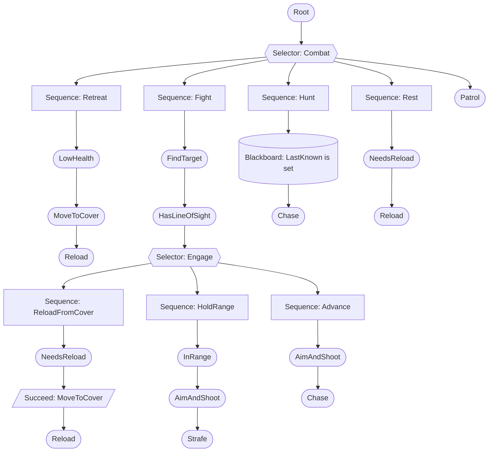

# Adding NPCs

NPCs pick up the same guns as players and fight like them. Every NPC shot goes through `GunService.FireAs`, so damage, headshots, abilities, effects and sounds are the players' own, and a new gun works on NPCs with no extra code. Their decisions come from a behavior tree built with **BehaviorTreeCreator** (BTrees V5), which you can open and edit in the **BTrees Editor** plugin.

## How an NPC decides

The `Soldier` tree in `ServerStorage.NPC.Trees` is re-run about 7 times a second per NPC. A Selector tries its branches top to bottom and takes the first that succeeds; a Sequence runs its children in order and stops at the first failure.



Most tasks finish in one tick (they set intent and return), so the tree reacts every tick. Only `MoveToCover` and `Reload` return RUNNING, which pauses the tree on them until they are done.

Shooting runs every frame in `NPCService`, not in the tree: `AimAndShoot` only says "fire at the target this tick". That keeps a 600 RPM rifle at its real rate between decision ticks.

## Folder map

```
ReplicatedStorage
├─ Content/NPC/
│  ├─ Types               NPCProfile and Difficulty types
│  └─ Profiles/           one ModuleScript per NPC type: Soldier, Breacher, Grenadier
ServerStorage/NPC
├─ Templates/Soldier      the rig (R15, from a HumanoidDescription)
└─ Trees/Soldier          the behavior tree folder, tagged _BTree
ServerScriptService/Modules/Systems
├─ NPC/
│  ├─ NPCService          spawning, scheduler, aiming and shooting, cleanup
│  ├─ Brain               what tasks share: agent type, line of sight, pathing, ammo, the NPCWorld blackboard
│  └─ Tasks/              FindTarget, HasLineOfSight, InRange, LowHealth, NeedsReload,
│                         MoveToCover, Strafe, Chase, AimAndShoot, Reload, Patrol
└─ Guns/GunService        GiveNPC, FireAs, ReloadAs, ShooterOf, RemoveShooter
Workspace
├─ Enemies                live NPCs (Client.Hud.HealthBillboards gives them health bars)
└─ NPCTestArea            three NPCSpawn parts and some cover crates for testing; delete when you have a map
```

## Add an NPC type

1. Add a `ModuleScript` to `ReplicatedStorage.Content.NPC.Profiles`. Only the fields you change are needed; the rest take the defaults below.

   ```lua
   --!strict
   --[[
   	Sniper: stays far back and lands most shots once it has settled on you.
   ]]

   return {
   	Id = "Sniper",
   	DisplayName = "Sniper",
   	Guns = { "Rifle" },
   	SightRange = 300,
   	FOV = 70,
   	PreferredRange = 120,
   	Difficulty = { ReactionTime = 0.9, AimError = 4, MinAimError = 0.4, AccuracyRamp = 2, LongRangeMiss = 0.1 },
   }
   ```

2. Spawn it:
   - **In game:** run `spawnnpc Sniper 3` in Cmdr. It spawns 40 studs in front of you, and these don't respawn.
   - **From a spawn point:** tag a part `NPCSpawn` and give it a `Profile` attribute of `Sniper`. Its NPC spawns when the server starts and comes back `RespawnDelay` seconds after dying.
3. Remove every NPC with `clearnpcs`.

| Field | Default | Meaning |
| --- | --- | --- |
| `Id` | file name | The name used by `spawnnpc` and the `Profile` attribute |
| `DisplayName` | `Id` | The model's name, shown on its health bar |
| `Template` | `Soldier` | Rig in `ServerStorage.NPC.Templates` |
| `Tree` | `Soldier` | Tree folder in `ServerStorage.NPC.Trees` |
| `Team` | `Hostile` | NPCs fight anyone not on their team; players are on `Players` (or their Roblox `Team`). NPC bullets never hurt their own team |
| `Guns` | `{ "Rifle" }` | Gun Ids; one is picked at random each spawn |
| `Health` | `100` | |
| `WalkSpeed` | `14` | |
| `SightRange` | `180` | Studs |
| `FOV` | `120` | Degrees of vision cone. Anything within 12 studs, or anyone who just hurt it, is noticed anyway |
| `PreferredRange` | `40` | Studs it likes to fight from; it closes in or backs off toward this |
| `LowHealth` | `0.3` | Share of health below which it retreats to cover once |
| `RespawnDelay` | `8` | Seconds, for NPCs from spawn points |
| `InfiniteAmmo` | `true` | The reserve never runs out (magazines and reloads still apply) |
| `Difficulty.ReactionTime` | `0.5` | Seconds from first seeing a target to the first shot |
| `Difficulty.AimError` | `6` | Degrees of aim error when a target is first seen |
| `Difficulty.MinAimError` | `1.5` | Degrees of aim error after tracking for a while |
| `Difficulty.AccuracyRamp` | `2.5` | Seconds for the error to settle most of the way |
| `Difficulty.LongRangeMiss` | `0.3` | Chance a shot past twice `PreferredRange` is thrown wide on purpose |

Fire mode comes from the gun. Semi guns tap every 0.25–0.55 s, Auto guns fire bursts of 3–6, and Burst guns fire their full burst, each with a short pause after.

## Write a task module

A task is a `ModuleScript` with `start`, `run` and `finish`. Only `run` is required. `run` gets the NPC's agent and returns one of:
- `Brain.SUCCESS`
- `Brain.FAIL`
- `Brain.RUNNING`, which pauses the tree on this task until a later tick.

Put it in `ServerScriptService.Modules.Systems.NPC.Tasks`.

Rules for tasks that run every tick:
- **No new tables per tick.** Keep state on the agent, and use `Brain` for raycasts: its `RaycastParams` and filter tables are made once and reused.
- **Move through `Brain.MoveTo` or `Brain.MoveDirect`.** `MoveTo` re-paths at most every 0.5 s, and a stalled walk is retried, then re-pathed.
- **Shoot by setting `agent.WantFire`.** `NPCService` fires on its own clock, through `GunService.FireAs`.
- **Read other combatants from `Brain.World`** (the shared blackboard `NPCWorld`), never from `workspace`.

Example: **TakeHigherGround** walks to the highest nearby point before a fight. It keeps its state on `agent.Blackboard`, which the tree's Blackboard Query nodes can also read; for typed state, add a field to the `Agent` type in `Brain` and set it in `NPCService.Spawn`.

```lua
--!strict
--[[
	Tasks.TakeHigherGround (action)

	Before engaging, walks to the highest of a few nearby points, so the NPC fights from above when it can.

	SUCCESS  it is there, or no higher point was found
	RUNNING  on the way
]]

local Brain = require(script.Parent.Parent.Brain)

local SAMPLES = 8
local RADIUS = 18
local ARRIVED = 3
local MIN_GAIN = 2 -- Studs higher than where it stands to be worth the walk
local PROBE = Vector3.new(0, -50, 0)

local params = RaycastParams.new()
params.FilterType = Enum.RaycastFilterType.Exclude
local filter: { Instance } = {}

local TakeHigherGround = {}

function TakeHigherGround.start(agent: Brain.Agent)
	filter[1] = agent.Model
	params.FilterDescendantsInstances = filter
	local origin = agent.Root.Position
	local best: Vector3? = nil
	local bestHeight = origin.Y + MIN_GAIN
	for sample = 1, SAMPLES do
		local angle = sample * (math.pi * 2 / SAMPLES)
		local above = origin + Vector3.new(math.cos(angle) * RADIUS, 25, math.sin(angle) * RADIUS)
		local hit = workspace:Raycast(above, PROBE, params)
		if hit and hit.Position.Y > bestHeight then
			best = hit.Position
			bestHeight = hit.Position.Y
		end
	end
	agent.Blackboard.HighGround = best
end

function TakeHigherGround.run(agent: Brain.Agent)
	: number
	local goal = agent.Blackboard.HighGround
	if not goal or Brain.FlatDistance(goal, agent.Root.Position) <= ARRIVED then
		return Brain.SUCCESS
	end
	Brain.MoveTo(agent, goal)
	return Brain.RUNNING
end

function TakeHigherGround.finish(agent: Brain.Agent, _status: number)
	agent.Blackboard.HighGround = nil
end

return TakeHigherGround
```

Then add a node for it in the tree (next section). A useful spot is a Sequence of `FindTarget` → `TakeHigherGround` placed before Fight, wrapped in `Succeed` so a failure doesn't stop the rest.

## Edit a tree in the BTrees Editor

The tree is a folder in the BTrees Editor V5 format, so the plugin opens it directly:

1. Select `ServerStorage.NPC.Trees.Soldier` (tagged `_BTree`) and open it from the BTrees Editor plugin.
2. Drag in nodes, connect outputs, and reorder children by their output number.
3. For one of the task modules, add an **External Task** node and set its `Source` parameter to the module in `Systems.NPC.Tasks`.

Folder format, if you edit by hand:

| Part | What it is |
| --- | --- |
| Tree folder | Tagged `_BTree`; holds `Nodes`, `Zoom` (NumberValue), `WorkspaceX` and `WorkspaceY` (Vector3Value) |
| `Nodes/Root` | Type `Root`, exactly one output: the top node |
| Node folder | `Type` (StringValue), `Position` (StringValue `"xScale,xOffset,yScale,yOffset"`), `Size` (Vector3Value), `Outputs` (Folder of ObjectValues named `1`, `2`… pointing at child node folders, in run order), `Parameters` (Folder, always with an `Index` IntValue) |
| `External Task` | `Parameters.Source` (ObjectValue) = the task ModuleScript |
| `Blackboard Query` | `Parameters.Board` = `Entity`, `Key` = a blackboard key, `Value` = `set`, `unset`, `true`, `false` or a string to compare |
| Other types | `Sequence`, `Selector`, `Random`, `While`, `Succeed`, `Fail`, `Invert`, `Repeat`, `Tree` |

A new tree: copy `Soldier`, rename it, and set a profile's `Tree` to the new name. `NPCService` builds each tree once with `BehaviorTreeCreator:Create(folder)` and shares it between every NPC that uses it.

## Add a kill sound variant

Hit sounds are variants of the `Hitmarker` effect in `ReplicatedStorage.Content.Effects.Registry`. `Client.Guns.GunHud.Hitmarker` picks one per hit, the first that applies:

| Variant | When | Sounds |
| --- | --- | --- |
| `HeadshotKill` | The hit killed, on the head | Click, `HeadshotHit`, then `KillConfirm` and `KillThump` 0.05 s later |
| `Kill` | The hit killed | Click, `KillConfirm` (the headshot sound at 0.75 speed), `KillThump` (the body hit at 0.55) |
| `Headshot` | Head, not a kill | Click, `HeadshotHit` |
| none | Body, not a kill | Click, `BodyHit` |

The server reports a kill only on the hit that takes a humanoid from above 0 health to 0 or below. So one kill plays one sound, and a corpse plays nothing. To add a variant, for example a multi-kill:

1. Put the sound in `ReplicatedStorage.Assets.Sounds`.
2. Add a variant beside `Kill`: `MultiKill = { Sound = { { Asset = "Hitmarker", Volume = 0.8, Global = true }, { Asset = "MultiKill", Volume = 1, Global = true } } }`.
3. Choose it in `GunHud.Hitmarker`. To know it was a multi-kill, count kills with the `Gun.Killed` extension point on the server and send that to the client.

## Kill credit and extension points

- **Who can attack:** `Combat.ApplyHit` takes an `Attacker` that is a `Player` or an NPC's `Model`. `Combat.DamageLog` records hits on players and NPCs alike, so `DamageLog.Last(victim, seconds)` names whoever hit last, player or NPC.
- **`Gun.Killed`** (`attacker, victimHumanoid, gunId, headshot`) fires once per kill, for players and NPCs. Hook a kill feed or streaks to it.
- **`who` argument:** every gun extension point gets the Player, or the NPC's model, as `who`. That's how `NPCService` turns off friendly fire: a `Gun.DamageMultiplier` handler returns 0 for same-team NPCs.

## Performance

- **NPC cap:** `MAX_NPCS` (30) in `NPCService` limits live NPCs. Spawns past it are refused with a warning.
- **One Heartbeat:**
  - Decisions run round-robin, at most 10 NPCs per frame, each about 7 times a second.
  - Turning and path following run every frame for NPCs within 200 studs of a player. NPCs farther out snap on their decision tick.
- **Sleep:** NPCs more than 350 studs from every player sleep. They don't think, move or shoot.
- **Pathfinding:**
  - Each NPC has one `Path` for its whole life.
  - A new path is computed at most every 0.5 s, in its own thread, so the scheduler never waits on it.
- **No per-tick allocation in hot tasks:**
  - Raycast params and filter tables are cached in `Brain`.
  - The combatant list (`Brain.World`) reuses one entry per character.
- **Shots:**
  - NPC shots use the same pooled FastCast2 casters and registry effects as players.
  - Gunfire uses `Nearby` replication, and tracers reach clients through `UnreliablePackets.GunFired` with the NPC's Id.
  - Clients do nothing extra per NPC.
- **Measured in Studio:** with 20 NPCs fighting, the server held 60 fps. `Stats.HeartbeatTimeMs` averaged 0.55 ms (max 0.95 ms), and 5 of 603 frames went over 20 ms.

## Troubleshooting

| Symptom | Likely cause | Fix |
| --- | --- | --- |
| `NPCService.Spawn: no profile named X` | Typo, or the profile file failed to load (see Output) | Check `Content.NPC.Profiles` |
| `missing template X or tree Y` | `Template` or `Tree` names something that isn't there | Check `ServerStorage.NPC.Templates` and `Trees` |
| `could't build tree; external task node had no source` | An External Task node has no `Source` | Set `Parameters.Source` to the task module |
| The BTrees Editor errors with `Index is not a valid member` | A hand-made node has no `Parameters.Index` | Add an `Index` IntValue to every node's `Parameters` |
| NPCs stand still | They are asleep (no player within 350 studs), or the tree fails at the root | Move closer; open the tree in the editor while playing to watch the live node |
| NPCs see you but never shoot | You are behind cover they can't shoot through, or `ReactionTime` is long | They aim at the head when the chest is hidden; check the profile's `Difficulty` |
| NPCs walk into walls | Pathfinding found no route, so they walk straight | Give the map gaps of at least 4 studs; NPCs re-path after 4 s on one waypoint |
| NPC shots show no tracers for some players | `GunFired` is unreliable, or the player is more than 600 studs away | Expected; raise `TRACER_RANGE` in `GunService` if needed |
