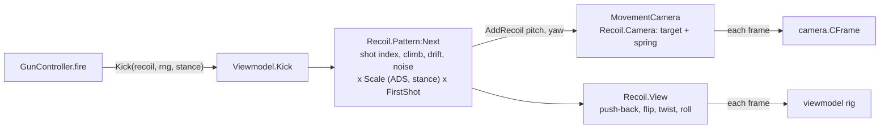

# Gun system architecture

A short map of how guns work. For adding guns and abilities, see [ADDING_GUNS.md](ADDING_GUNS.md); for NPCs, [ADDING_NPCS.md](ADDING_NPCS.md).

## Principles

- **Data-driven.** A gun is a definition in `Content.Guns.Definitions` plus a model in `Assets.Models.Guns`. Behavior beyond stats lives in ability modules (`Content.Guns.Abilities`) made of hooks.
- **Server-authoritative.** Clients send intent only: fire (server timestamp, origin, direction, seed, spread), reload, aim and ability key. The server owns ammo, fire rate, the spread floor, hits, headshots and damage.
- **Players and NPCs are both shooters.** `GunService` keys held guns by character. A `Shooter` is `{ Character, Player?, Id }` (a UserId, or a negative NPC Id). Players fire through the packet handler `Fire`, which adds the timestamp and origin checks; NPCs fire through `FireAs`. Both pass the same `tryShot` checks (state, `Gun.PreventFire`, fire rate, ammo) and the same `shoot`.
- **Same shot everywhere.** `Shared.Guns.Ballistics` builds a shot from a seed. The shooter, the server and other clients run the same `OnFire` hooks with `Random.new(seed)` and get the same pellets.
- **Built on the existing framework.** Modules load through `ModuleLoader`; networking goes through `Shared.Packets` and `Shared.UnreliablePackets`; damage through `Combat.ApplyHit`; effects through `Content.Effects.Registry` with `EffectService` and `Client.Effects`; states through `StateHandler`; rules through `Shared.Extensions`.

## Shot flow

| Step | Where | What happens |
| --- | --- | --- |
| 1 | `Client.Guns.GunController` | The Heartbeat fire loop checks the fire mode, interval, state and predicted ammo |
| 2 | `Shared.Guns.Ballistics` | Builds the shot from the camera with a new seed, runs `OnFire`, fills the pellet directions |
| 3 | `GunController` | Sends `Packets.Gun.Fire`, then plays the shot locally (`GunEffects`) and kicks the camera and gun (`Viewmodel.Kick`, see [Recoil](#recoil)) |
| 4 | `Systems.Guns.GunService` | Checks the held Tool, state (`Stunned`, `CantDoAnything`, `Reloading`), movement (`MovementService.BlocksFire`: no shots while sprinting or inside `SprintOutTime`), `Gun.PreventFire`, the minimum interval and `TokenBucket`, the timestamp and ammo |
| 5 | `GunService` | Clamps the origin to 4 studs from the head with line of sight, and the spread to `[Spread.MinAngle, Spread.Max]` |
| 6 | `GunService` + `Ballistics` | Rebuilds the pellets. Hitscan: `Ballistics.Trace` with the same pierce rule. Projectile: the gun's server FastCast2 caster |
| 6a | `Ballistics` (`decidePierce`) | After each surface: falling soft wall debris is skipped; a soft wall lets the bullet through (`MaxWallsPerBullet`, damage × the gun's `PenetrationMultiplier` per wall) and, on the server, cuts a hole through `GunService`'s `punchSoftWall` → `Systems.Destruction.SoftWalls.Punch`; then ability `CanPierce` (bounces), then `Projectile.Pierce`. See [SOFTWALLS.md](SOFTWALLS.md) |
| 7 | `Systems.Guns.AbilityRunner` | Per bullet: falloff, headshot, the soft walls it passed (`bullet.Data.SoftWallMultiplier`), `Gun.DamageMultiplier`, `OnHit`, then `Combat.ApplyHit` (shotgun pellets on one humanoid are added up into one hit), then `Gun.Hit` and `Packets.Gun.HitConfirm` |
| 8 | `GunService` | `EffectService.Play(GunFire_<Id>)` to nearby players except the shooter; `UnreliablePackets.GunFired` so they draw the tracers |

## Loadouts and switching

1. On every spawn `Systems.Guns.LoadoutService` reads the player's saved `Loadout`, removes their old gun Tools, gives the loadout's guns through `GunService.Give` with `Slot` 1–3, and equips slot 1. Each gun is styled with the player's equipped skin (`SkinShopService.StyleTool`, see [SKINS.md](SKINS.md)). While the player's `InLobby` attribute is true they get no guns ([LOBBY.md](LOBBY.md)). Kills are shown in the kill feed ([KILL_FEED.md](KILL_FEED.md)).
2. `Client.Guns.WeaponSlots` turns off Roblox's hotbar and equips Tools itself (`Humanoid:EquipTool` on the client) from the Slot keys, the mouse wheel, gamepad L1/R1 and the slot strip in `Main.Weapons`. `GunController` and `GunService` react to the equip as before.
3. Picking a loadout in `Client.Guns.LoadoutMenu` sends `Packets.Gun.Loadout`. The server saves it and gives it at once unless the player is firing or reloading; a `TokenBucket` stops it being used to refill ammo.

## Settings

Keybinds and volumes live in the player's Scribe data under `Settings` (declared by `Shared.PlayerSettings`, a ScribeFragment). The client loads them at start (`Client.Settings.Keybinds`, `Client.Audio.AudioSettings.Store`) and sends changes through `Packets.Settings`; `Services.SettingsService` checks the action, key or group name and writes it. A slider's changes are sent once it has been still for 0.5 s.

## State

| Where | What |
| --- | --- |
| `Tool` attributes `GunId`, `Ammo`, `Reserve` | Server-owned. The client predicts ammo between shots and resyncs from `Ammo` |
| `Tool` attribute `Slot` | The weapon slot (1–3), set by `LoadoutService`, or the next free slot by `GunService.Give` |
| Player data `Loadout`, `Settings.Keybinds.*`, `Settings.Volumes.*`, `Settings.Options.*` | Saved with ProfileStore; written only by the server |
| Player attributes `Sprinting`, `Crouching`, `Sliding`, `MoveState`, `MoveSpeedMultiplier` | Set by `Systems.Movement.MovementService` (predicted on the owner's client). Read by the viewmodel poses and third-person poses |
| `StateHandler` `Reloading` | Set on the server while reloading; the client's reload bar follows it |
| `StateHandler` `Firing` | On while shots keep arriving, off 0.15 s after the last one |
| `Held` table in `GunService` | Equipped gun, last shot time, aiming, reload token |

## Networking

| Packet | Direction | Payload |
| --- | --- | --- |
| `Packets.Gun.Fire` | Client → server | F64 time, Vector3 origin, Vector3 direction, U32 seed, F32 spread |
| `Packets.Gun.Reload` | Client → server | none |
| `Packets.Gun.Aim` | Client → server | Boolean |
| `Packets.Gun.AltFire` | Client → server | Boolean (only for server-side `OnAltFire`) |
| `Packets.Gun.HitConfirm` | Server → shooter | Boolean headshot, Boolean killed |
| `Packets.Gun.Loadout` | Client → server | Loadout Id |
| `Packets.Melee.Swing` | Client → server | F64 time, Vector3 look direction (a gun bash; the server finds the hit in `Systems.Combat.GunMelee`) |
| `Packets.Settings.Keybind` | Client → server | Action name, key name |
| `Packets.Settings.Volume` | Client → server | Sound group name, F32 volume |
| `Packets.Settings.Option` | Client → server | Option name (FOV, camera bob, toggles), F32 value |
| `Packets.Movement.SetState` | Client → server | Movement state name |
| `Packets.Movement.Correct` | Server → one client | The server's movement state, after a refused change |
| `UnreliablePackets.GunFired` | Server → nearby clients | UserId, gun Id, origin, direction, seed, spread |
| `UnreliablePackets.GunAim` | Client → server | Aim pitch, at 10 Hz |
| `UnreliablePackets.GunAimRelay` | Server → nearby clients | UserId, pitch (tilts the right arm on R6, the waist on R15; works with Motor6D and AnimationConstraint joints) |

## Client frame

- **RenderStep at Camera + 1** (`Client.Movement.MovementCamera`): owns the camera's offsets and FOV. The gun's camera recoil (a `Recoil.Camera`), aim zoom (`base FOV × ADSFov / 70`) and a scope's FOV live here, in one spring stack with the movement height, tilt, landing dip and bob. See [MOVEMENT.md](MOVEMENT.md).
- **RenderStep at Camera + 2** (`Viewmodel`): tells MovementCamera how far it is aimed in, then places the 32%-scale rig, in this order:
  1. hip/ADS blend, walk bob, sway from camera turn speed, and the gun's own recoil (`Recoil.View`: push-back, flip, twist, roll, pivoting on the sight line as it aims in);
  2. sprint, crouch, slide and prone poses, the wall tuck at the hip (lifts the muzzle when a wall or the floor is closer than it), the equip raise, and the procedural reload, inspect, knife swing or gun bash (`Viewmodel.Actions`);
  3. FOV compensation at the hip;
  4. a near guard that pushes the gun along the view axis so no part reaches the camera's 0.1-stud near clip plane (sights stay centered; see [MOVEMENT.md](MOVEMENT.md#keeping-the-gun-whole-near-clip-and-walls));
  5. the left hand and magazine for a running reload or inspect.

  In first person it hides the character's arms and the third-person Tool locally. The viewmodel's gun copies are made once per model (`Viewmodel.GunModel`) and wear the player's skin, applied at full size and scaled down.

### Recoil

Recoil is the shooter's aim feel only; the server never sees it. All of it is driven by the gun's `Recoil` fields ([ADDING_GUNS.md](ADDING_GUNS.md#recoil-fields)), and the math is in `Client.Guns.Recoil`, which needs no player or camera, so it can be tested in Edit mode.

1. **On a shot,** `Viewmodel.Kick` asks the gun's `Recoil.Pattern` for the next kick: the spray's shot number (it restarts after `ResetTime`), the climb and drift for that shot, plus a small random part, times `Recoil.Scale` (ADS blend, crouch or prone) and `FirstShot` on shot 1.
2. **The camera half** goes to `MovementCamera.AddRecoil`. Its `Recoil.Camera` adds the kick to a target and a spring follows it (`CameraSpeed`, `CameraDamping`, `CameraSnap`; at least `RateSnap ×` shots per second fast).
3. **The gun half** goes to `Recoil.View`, a separate spring pair (`ViewSpeed`, `ViewDamping`).
4. **Every frame,** MovementCamera measures the player's own turn (the camera script's change since its last write). Turning against the recoil is absorbed: it comes out of the target, and the camera's offset bookkeeping is shifted so the camera doesn't move twice. `RecoveryDelay` after the last shot, the target eases back to zero at `Recovery`, so recovery returns only the recoil the player didn't pull against.
5. The recoil offset is applied as a per-frame change in the same stack as dip, tilt and bob, so nothing fights over the camera. Switching guns reconfigures the springs; recoil already on the camera keeps recovering.

Nothing in this path makes tables per shot or per frame: the three recoil objects are made once and configured on equip.
- **Heartbeat** (`GunController`): fire loop, bloom recovery, reload tracking, aim pitch, crosshair gap, and hiding the crosshair while aiming.

Aiming lines each gun's `Aim` attachment up with the camera, so you look down its iron sights; only a gun with the `Scope` ability gets a scope overlay.

Both exist only while a gun is held. The camera is locked to first person while a gun is held.

## Kills

`AbilityRunner.ApplyHit` reads the victim's health before `Combat.ApplyHit` and reports a kill only when that hit took it from above 0 to 0 or below. A player shooter gets `Packets.Gun.HitConfirm(headshot, killed)`, which picks the hit sound (HeadshotKill, Kill, Headshot or body). Every kill fires `Gun.Killed(who, victimHumanoid, gunId, headshot)`. `Combat.DamageLog` records attackers and victims that are players or NPC models.

`UnreliablePackets.GunFired` carries the shooter's Id: a UserId, or an NPC's Id. NPC models are tagged `NPC` with an `NPCId` attribute, and `Client.Guns.GunEffects` looks them up so NPC tracers start at their gun's muzzle.

## Known limits

- **No lag compensation.** The server hits targets where it sees them when the shot arrives.
- **No animations ship.** `Animations` ids are empty; motion comes from springs and the procedural reload, inspect, swing and bash in `Viewmodel.Actions`. Ids put in a definition play on the viewmodel rig through `AnimationHandler`.
- **Recoil is client-side.** Bullets go where the camera points when the shot is sent, so recoil changes where shots land only through the camera; the server doesn't check recoil.
- **Ammo resets on respawn.** The loadout is given fresh on every spawn, with full magazines and reserve.
- **Mouse can't click the HUD while a gun is held.** First person locks the cursor to the center; menus open with keys on PC and by tap on touch.
