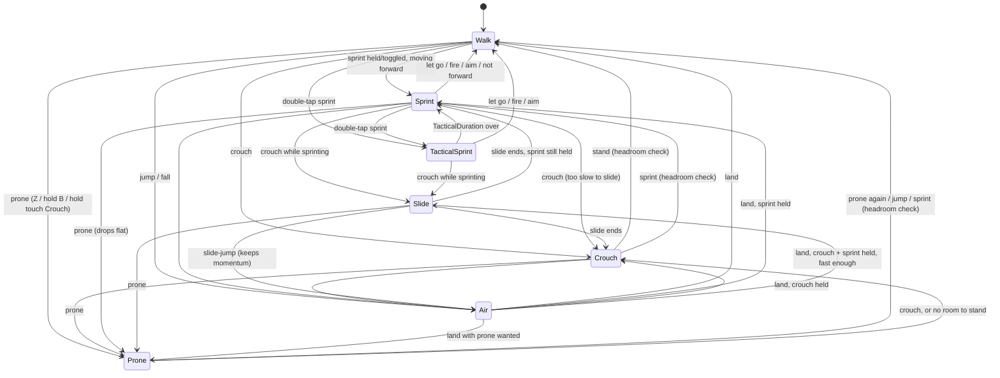

# Movement and camera feel

How sprinting, crouching, sliding, the camera and the FOV setting work in the FPS place, and how to tune them or add a state. For guns see [ADDING_GUNS.md](ADDING_GUNS.md); for the shot flow, [GUN_SYSTEM.md](GUN_SYSTEM.md).

## At a glance

- **The client moves first.** `Client.Movement.MovementController` runs a small state machine on the player's own client, so input responds the same frame. It tells the server about each state change, and nothing is sent per frame.
- **The server decides what's legal.** `Systems.Movement.MovementService` checks every change against the shared transition table, cooldowns and the player's state. It refuses or corrects illegal ones, sets the attributes and WalkSpeed, and checks speed 4 times a second.
- **It works with the default Humanoid.**
  - Speed comes from WalkSpeed, crouching from HipHeight.
  - Slides and slide-jump momentum come from one `LinearVelocity` made per character and reused.
  - The character controller is not replaced.
- **The camera is layered, not replaced.** `Client.Movement.MovementCamera` adds height, FOV, tilt, landing dip, bob and gun recoil on top of the default camera, in one spring stack.
- **Every number is in one file:** `ReplicatedStorage.Content.Movement.Config`.

## Files

```
ReplicatedStorage
  Content/Movement/Config              every tunable number
  Modules/Shared/Movement/States       state flags + the transition table
  Modules/Client/Movement/
    MovementController                 input -> state machine, physics, footsteps (one Heartbeat)
    MovementCamera                     height, FOV, tilt, dip, bob, recoil, shake (one RenderStep, Camera + 1)
    MovementPoses                      third-person crouch/slide poses for every character (one Stepped)
    MovementDebug                      the movedebug readout
  Modules/Client/Settings/Options      FOV, camera bob and the toggles (load, preview, save)
  Modules/Client/Settings/Slider       shared slider drag + snap, used by every settings slider
ServerScriptService/Modules/Systems/Movement/
  MovementService                      validation, attributes, WalkSpeed/HipHeight, speed check
```

## States



| State | Speed | Sets | Notes |
| --- | --- | --- | --- |
| `Walk` | `WalkSpeed` | — | Default |
| `Sprint` | `SprintSpeed` | `Sprinting` | Only while moving mostly forward (`SprintForwardDot`). Blocks firing and ADS |
| `TacticalSprint` | `TacticalSprintSpeed` | `Sprinting` | Double-tap sprint. Lasts `TacticalDuration`, cooldown `TacticalCooldown`; guns take `SprintOutTime × TacticalOutMultiplier` to fire after |
| `Crouch` | `CrouchSpeed` | `Crouching` | HipHeight lowered by `CrouchHipDrop`. Crouch spread (`Spread.Crouch`). Can't stand under a ceiling |
| `Slide` | burst, then friction | `Crouching`, `Sliding` | Starts at `max(speed × SlideBoost, SlideStartSpeed)`. Faster downhill, slower uphill. Hip fire allowed with `Spread.Slide` extra spread. Cooldown `SlideCooldown` |
| `Prone` | `ProneSpeed` | `Prone` | Lying down. HipHeight lowered by `ProneHipDrop`, eye `ProneEyeDrop` lower. Best spread (`Spread.Prone`), can fire and aim, can't jump (a jump press gets up), no footsteps. `ProneCooldown` between going down and getting up |
| `Air` | carried | — | A slide-jump keeps `SlideJumpKeep` of the slide's speed, with limited air control. Landing makes a camera dip scaled by fall speed |

Each change sets the `Sprinting`, `Crouching`, `Sliding` and `Prone` **player attributes**. MovementController predicts them at once; the server sets the same values through `StateHandler`, so `StateHandler.GetState(player, "Sprinting")` works in server code. The server also sets `MoveState` (the state name), `MoveSpeedMultiplier`, `StandHipHeight` and `MoveViolations`.

## Input

| Action | Keyboard (rebindable) | Gamepad | Touch |
| --- | --- | --- | --- |
| Sprint | Left Shift (double-tap: tactical) | Left stick click (toggle) | `Main.Mobile.SprintButton` (tap toggles). Pushing the thumbstick fully forward auto-sprints when **Auto-sprint (touch)** is on |
| Crouch / slide | C, or Left Ctrl (`CrouchAlt`) | B | `Main.Mobile.CrouchButton` (tap toggles; slides while sprinting) |
| Prone | Z (press again to get up) | Hold B (`ProneHoldTime`) | Hold `CrouchButton` |
| Jump | the Humanoid's jump | A | the Roblox jump button |

The Settings menu's **Movement** section has these toggles:
- Sprint: Hold or Toggle.
- Crouch: Hold or Toggle.
- Auto-sprint (touch).
- Sprint while reloading: off by default, so a reload stops a sprint and you can't sprint until it ends.

While a menu is open, movement keys are ignored. Shift-lock is turned off in `StarterPlayer`, because Left Shift is the sprint key.

## Guns and movement

- **Sprinting blocks firing and aiming.** Pulling the trigger or pressing aim ends the sprint, and the gun fires or aims once its `SprintOutTime` has passed. Holding the trigger or aim stops a new sprint from starting.
- **The server enforces the same rule.** `GunService.tryShot` asks `MovementService.BlocksFire(player, gun)`, which refuses a player's shot while sprinting and for `SprintOutTime × SprintOutTolerance` after (more after a tactical sprint).
- **Spread:**
  - `Shared.Guns.Spread.Angle(gun, aiming, moveAlpha, bloom, stance)` takes `"Crouch"`, `"Slide"` or `nil`.
  - On the server, `Spread.MinAngle(gun, aiming, crouched)` accepts the tighter crouch cone while `MovementService.IsCrouched` says the player is crouched, or was a moment ago.
- **Gun weight:** a held gun's `MoveSpeedMultiplier` scales every speed.

## Camera feel

`MovementCamera` has one `BindToRenderStep` at `Camera + 1`. The gun viewmodel runs after it, at `Camera + 2`.

| Layer | How |
| --- | --- |
| Height | `Humanoid.CameraOffset` springs to `CrouchEyeDrop` / `SlideEyeDrop`. The body's own HipHeight drop is taken out, so the view moves smoothly even though HipHeight changes at once |
| FOV | Base = the player's **Field of view** setting. Additive kicks ease in: `FovSprint`, `FovTacticalSprint`, `FovSlide`. Aiming blends to `base × gun.ADSFov / ReferenceFov`. A scope's FOV is scaled the same way |
| Tilt | `StrafeTilt` degrees of roll into the strafe, `SlideTilt` while sliding |
| Landing dip | Pitch impulse of `LandDipPerSpeed` per stud/s of fall speed (capped at `LandMaxDip`) that springs back |
| Bob | Up, side and roll from the footstep phase, scaled by speed and cut to `BobAds` while aiming |
| Recoil | The gun's camera recoil (`Viewmodel.Kick`) and a small per-shot roll go into the same stack, so the layers never fight |
| Shake | `MovementCamera.Shake(...)` uses CameraShaker, for impacts and explosions only |

The **Camera bob** setting (0–100%) scales bob, tilt and the landing dip; 0 turns them off.

The default camera script rebuilds the camera each frame from last frame's look direction. So pitch and yaw offsets are applied as the change since last frame, and roll, which the script drops, is applied in full every frame. When every spring is at rest and the FOV is already set, the step returns at once.

The viewmodel keeps its size on screen across FOV settings by pulling its hip offset closer at high FOV. How much is set by `ViewmodelFovCompensation` and `ViewmodelMinScale`. At full aim there's no scaling, so the sights stay on the camera's axis; at FOV 60 and 110 the sight point sits exactly at screen center.

## FOV setting

`Shared.PlayerSettings.Options` declares `Fov = Scribe.Number(80, { Min = 60, Max = 110 })`, saved under `Settings.Options` like the volumes.

- **While dragging,** the slider in **Display** applies the FOV at once (`Options.Set(name, value, true)`).
- **On release,** it saves through `Packets.Settings.Option` → `Services.SettingsService`, which cleans the value and writes it.

**Camera bob** works the same way.

## Effects

| Registry entry | When | Notes |
| --- | --- | --- |
| `SlideStart` | Slide starts | Scrape sound + dust at the feet. Played locally; the server sends it to nearby players |
| `SlideLoop` | During a slide | Persistent looped scrape, stopped when the slide ends |
| `Land` | Landing from a fall ≥ `LandMinFallSpeed` | Volume scales with fall speed |
| `Footstep` | Every stride (`StrideWalk` / `StrideSprint` / `StrideCrouch` studs) | Variants `Concrete`, `Grass`, `Soft`, `Wood` and `Metal`, picked from the floor material. Each client plays them for nearby characters (up to `MaxOtherSteppers`), so nothing is sent |

Sounds go through `PooledSound`, which now supports `Looped` and a per-play `Data.Volume`. Dust uses the new pooled `Dust` part, which keeps one emitter per asset and scales the count by graphics quality, with fewer on touch devices. The default Roblox running sound is muted so footsteps don't double up.

**Sounds:** free Creator Store audio, in `Assets.Sounds`: `FootstepConcrete`, `FootstepGrass`, `FootstepGrass2`, `FootstepWood`, `FootstepMetal`, `SlideStart`, `SlideLoop`, `Land`.

**Dust:** emitters in `Assets.Vfx`: `SlideDust`, `LandDust`, `StepDust`.

## Third person

Other players see crouch and slide through `Client.Movement.MovementPoses`, driven only by the replicated attributes.

- **With animation ids:** if `Config.Animations.Crouch`, `CrouchWalk` or `Slide` hold ids, they play through `AnimationHandler`.
- **Without them** (the default), a pose is laid over the Animator's output: bent hips and knees for a crouch, one leg forward and a lean back for a slide, and the whole body tipped flat onto its front for prone (lowered by `ProneBodyDrop`, head raised).
- **Your own character while prone:** its body parts move to the `ProneBody` collision group, which collides with nothing; the server registers it at start. The Humanoid keeps the torso's `CanCollide` on, so without this the lowered torso would lift the character off the floor. The root part keeps colliding, and the parts go back to their own groups on getting up.
- **Joint types:** it works with Motor6D and with the newer `AnimationConstraint` joints this place's R15 rigs use.
- **R6:** these characters only lower the camera.

## Tuning feel

Change `Content.Movement.Config`, then start a new playtest; it's read once at load. Some starting points:

- **Snappier sprint:** raise `Acceleration`.
- **Longer slides:** lower `SlideFriction`, or raise `SlideStartSpeed`.
- **Steeper slopes matter more:** raise `SlideSlopeGravity`.
- **Less motion:**
  - Lower `BobUp`, `BobSide` and `StrafeTilt`. Players can also set **Camera bob** to 0.
  - Lower the FOV kicks.
- **Stricter server:**
  - Lower `SpeedTolerance` and `SpeedSlack`.
  - Raise `SprintOutTolerance` toward 1. Keep it below 1 so laggy players' first shot isn't refused.

Use the Cmdr command **`movedebug`** to show a live readout: client and server state, speed, WalkSpeed and multiplier, HipHeight, grounded and floor, FOV, flags and violations.

## Adding a state (dive, mantle…)

Prone was added this way, so it's a worked example to copy.

1. **`Shared.Movement.States`:**
   - Add the state to `Info` with its flags (`Sprinting`, `Crouched`, `Sliding`, `Grounded`).
   - Add its row to `TRANSITIONS`, and add it to the rows of the states that can enter it.
2. **`Content.Movement.Config`:** add its numbers.
3. **`Client.Movement.MovementController`:**
   - Add its speed to `SPEEDS`.
   - Handle entering and leaving it in `setState`, add a per-frame step in `onHeartbeat` if it needs one, and add the input that asks for it.
4. **`Systems.Movement.MovementService`:** add its speed to `SPEEDS` and any rule (cooldown, grounded check) in `allowed`.
5. **Optional:**
   - A camera height or FOV kick in `MovementCamera` (`eyeDropFor`, `FOV_KICKS`).
   - A pose in `MovementPoses`.
   - A viewmodel pose in `Client.Guns.Viewmodel`.

Nothing else changes: other systems read the attributes and `StateHandler` states.

## Extension points

| Point | Kind | Arguments | Use |
| --- | --- | --- | --- |
| `Movement.PreventSprint` | Any | `player, state` | `true` refuses Sprint / TacticalSprint (for example while carrying an objective) |
| `Movement.PreventSlide` | Any | `player` | `true` refuses a slide |
| `Movement.PreventProne` | Any | `player` | `true` refuses going prone |
| `Movement.SpeedMultiplier` | Product | `player, gunId?` | Scales every movement speed (perks, slows). The held gun's `MoveSpeedMultiplier` is applied on top. The server sends the result to the client as the `MoveSpeedMultiplier` attribute |

Add handlers on the server for rules. The client checks `PreventSprint` and `PreventSlide` too when a client-side handler exists, which saves a correction round trip.

## Server checks

| Check | Result |
| --- | --- |
| Change not in `TRANSITIONS`, player stunned or dead, cooldown not over, slide not grounded | Refused; `Packets.Movement.Correct` puts the client back |
| Stun or `CantDoAnything` during a sprint, crouch or slide | Server drops to Walk and corrects |
| More than `StateChangesPerSecond` packets | Dropped |
| Ground speed above `state speed × multiplier × SpeedTolerance + SpeedSlack` (slide speed allowed during and just after a slide) | Counted in `MoveViolations`; logged after `ViolationsToLog` samples in a row, at most once per `LogInterval`. Nobody is kicked |
| Shot while sprinting or inside `SprintOutTime` | Refused in `GunService.tryShot` |

## Viewmodel and shots

- **When the gun is drawn:** the viewmodel draws whenever the camera is in first person. That means `LockFirstPerson`, or the camera within 1.5 studs of its focus. It no longer measures from the head, because crouch, slide and prone poses move the head away from the eye.
- **Where tracers start:** cosmetic tracers and the muzzle flash start at the viewmodel's muzzle while it's drawn, and at the held Tool's own muzzle otherwise, never at the camera. The real bullets still aim from the camera.

## Known limits

- **Prone keeps the Humanoid's upright root part,** so you can't crawl under gaps lower than about 2.4 studs.

- **Normal jumps use the Humanoid's own air control.** Only slide-jumps carry extra momentum with limited air control.
- **No third-person animations ship.** The built-in leg pose is used until ids are set in `Config.Animations`.
- **The speed check measures ground speed only.** Vertical exploits such as fly or teleport aren't covered here.
